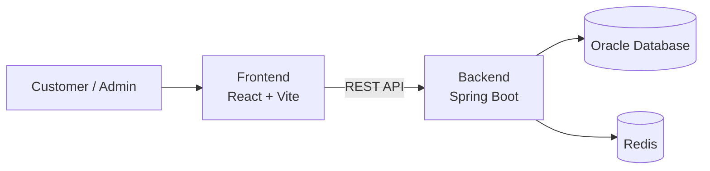

# ShopFlash

**ShopFlash** is an e-commerce web application with **Flash Sale** support, developed as part of the **Database Management Systems** course assignment.

The project uses a shared business domain to study and compare **Oracle Database** and **Redis** across several database topics, including data storage, indexing, query processing, transactions, concurrency control, and backup/recovery.

The goal of ShopFlash is not only to build a functional e-commerce application, but also to provide realistic workloads for evaluating the strengths, limitations, and suitable use cases of both database systems.

---

## Features

ShopFlash includes the following main feature groups:

| Feature Group | Description |
|---|---|
| **Product Management** | Manage categories, products, and information related to product sales |
| **Product Discovery** | Browse, search, filter, and sort products |
| **Shopping Cart** | Add, update, and remove products from the shopping cart |
| **Order Management** | Place orders, view order history, and manage order-related actions |
| **Flash Sale** | Purchase limited-quantity products during Flash Sale campaigns |
| **Reports & Analytics** | View revenue reports and business statistics |
| **Authentication & Authorization** | User authentication and role-based access for Customers and Admins |
| **Database Experiments** | Experiment with and compare Oracle and Redis using real application workloads |

The feature set may be extended during development to complete the business flows of the application.

---

## Tech Stack

### Frontend

| Technology | Purpose |
|---|---|
| **React** | Build the web user interface |
| **Vite** | Development server and frontend build tool |
| **Ant Design** | UI component library |

### Backend

| Technology | Purpose |
|---|---|
| **Java** | Backend programming language |
| **Spring Boot** | REST API and business logic |
| **Spring Security** | Authentication and authorization |

### Database

| Technology | Purpose |
|---|---|
| **Oracle Database** | Relational DBMS used for implementation and database experiments |
| **Redis** | In-memory NoSQL DBMS used for suitable workloads and comparison |

### Development

| Technology | Purpose |
|---|---|
| **Git / GitHub** | Version control and collaboration |
| **Docker** | Run databases and supporting services in the development environment when needed |

> Exact technology versions will follow the actual project configuration.

---

## Architecture

ShopFlash follows a standard web application architecture with three main layers:



### Application Flow

```text
User
  │
  ▼
React Frontend
  │
  │ HTTP / REST
  ▼
Spring Boot Backend
  │
  ├──────────► Oracle
  │
  └──────────► Redis
```

The **frontend** is responsible for the user interface and user interactions.

The **backend** exposes REST APIs, handles business logic, and acts as the communication layer between the client and the databases.

**Oracle** and **Redis** are used depending on the requirements of each workload and are also the two main DBMSs studied and compared in the project.

---

## Database Study

One of the main characteristics of ShopFlash is that its business flows are also used as practical contexts for database experiments.

| Topic | Typical Business Context |
|---|---|
| **Data Storage & Management** | Category and product data |
| **Data Backup & Recovery** | Backup, restore, and recovery of application data |
| **Indexing** | Product search and filtering |
| **Query Processing** | Reports and analytics |
| **Transaction** | Order placement |
| **Concurrency Control** | Flash Sale and concurrent operations |

Each topic is studied on both **Oracle** and **Redis**, followed by a comparison based on behavior, supported mechanisms, performance characteristics, and suitability for the corresponding workload.

---

## Project Structure

At a high level, the repository is organized into the following main areas:

```text
ShopFlash/
├── frontend/       # React web application
├── backend/        # Spring Boot REST API
├── db/             # Database design documentation
├── docs/           # Project documentation
└── README.md
```

The frontend and backend are organized around the main features and domains of ShopFlash.

---

## Getting Started

### Requirements

The main requirements for running the project locally include:

- Java Development Kit (JDK) 21
- Node.js
- Docker Engine with Docker Compose v2
- the Oracle Database Free and Redis Stack images pinned by digest in `compose.yaml` (see [`db/README.md`](db/README.md#versions))
- Git

### Clone the Repository

```bash
git clone <repository-url>
cd ShopFlash
```

### Start the Databases

Pull the two pinned images first (Compose never pulls them implicitly); the exact commands are in [`db/README.md`](db/README.md#setup). Then:

```bash
cp .env.example .env
# Replace the placeholder passwords in .env (letters, digits and _ only, starting with a letter).
docker compose up -d --wait
docker compose exec -T redis redis-cli -e --eval /opt/shopflash/redis/init.lua
```

The Oracle container creates user `SHOP` on start. Flyway applies the migrations as `SHOP` when the backend starts; profile `dev` also loads the local fixtures:

```bash
cd backend
./mvnw spring-boot:run -Dspring-boot.run.profiles=dev
```

See [`db/README.md`](db/README.md) for reset instructions.

### Run the Application

ShopFlash consists of the following main runtime components:

```text
Oracle / Redis
      ↓
Spring Boot Backend
      ↓
React Frontend
```

The backend uses Maven Wrapper, so a separate Maven installation is not required.

---

## Project Status

> 🚧 **Under Development**

The project is currently being developed around the following areas:

- product and category management;
- product search and filtering;
- reports and analytics;
- order processing;
- Flash Sale;
- Oracle vs. Redis experiments.

---

## About

ShopFlash is developed for the **Database Management Systems – Semester 261** course assignment.

The project focuses on using a realistic application domain to study how different database systems handle different types of workloads, rather than comparing them only at the theoretical level.
