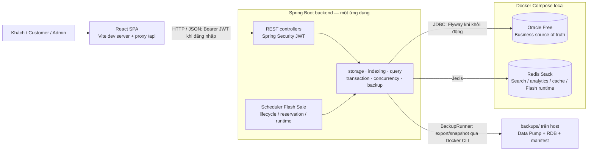

# Source Audit — Handoff cho Phần 1: ShopFlash

Khảo sát working tree ngày **16/11/2026**, nhánh `adjust-transaction`, HEAD `7870e6d2ba3d392ca64fafc705c47f68879a31e3`. FE và BE cùng repository. Đây là đầu vào để viết **2–3 trang A4**, chưa phải báo cáo hoàn chỉnh.

**Quy ước:** `VERIFIED FROM CODE` = đã đối chiếu mã nguồn/cấu hình; `DOCUMENTED DESIGN` = mục tiêu hoặc thiết kế trong tài liệu; `NOT VERIFIED` = chưa có đủ bằng chứng. Mã `[E..]` dẫn tới bảng Source Evidence. `IMPLEMENTED` xác nhận có luồng FE–BE và xử lý thật trong code, **không có nghĩa mọi feature đã được kiểm thử E2E trong lần audit này**; `PARTIAL` là mới hiện thực một phần phạm vi; `PLANNED` là được tài liệu nêu nhưng chưa có hiện thực tương ứng.

## 1. Verified Project Overview

- **DOCUMENTED DESIGN — Mục tiêu:** Oracle vs Redis, môn Database Management Systems, HK261. ShopFlash là ứng dụng bán lẻ có Flash Sale, cung cấp workload để thực nghiệm và lựa chọn DBMS phù hợp. Assignment yêu cầu app chạy trên ít nhất một DBMS, tối thiểu `2 × số thành viên` chức năng ngoài đăng nhập/đăng xuất. [E01]
- **DOCUMENTED DESIGN — Sáu topic:** Data storage & management; Indexing; Query processing; Transaction; Concurrency control; Data backup and recovery. Ngữ cảnh tương ứng: catalog, tìm kiếm, báo cáo, Cart/Order, Flash Sale và backup/recovery. [E01, E02]
- **DOCUMENTED DESIGN, đối chiếu VERIFIED FROM CODE — Phân vai:** Oracle giữ nghiệp vụ quan hệ cần lưu bền và nhất quán; Redis giữ search projection, runtime giữ suất và analytics/cache. Không suy ra Redis luôn nhanh hơn Oracle. [E04–E16]
- **VERIFIED FROM CODE — Phạm vi:** một web app, một backend sáu module; ghi nghiệp vụ chính ở Oracle, một số workload đọc/thực nghiệm chọn Oracle/Redis/cache. Các chức năng cụ thể ở mục 2; giới hạn ở mục 6. [E02, E06–E18]

## 2. Application Features

**VERIFIED FROM CODE — Người dùng:** khách chưa đăng nhập được xem/tìm sản phẩm và xem Flash Sale; `CUSTOMER` dùng giỏ hàng, đặt/xem/hủy đơn hợp lệ và giữ suất/mua Flash Sale; `ADMIN` quản trị catalog/Flash Sale, báo cáo, Lab và backup. Backend thực thi phân quyền; FE cũng bảo vệ khu vực quản trị. [E06]

ID dưới đây theo `AGENTS.md` gốc và module hiện tại. Quản lý Flash Sale thuộc F9; khác biệt F11 với kế hoạch cũ được giữ rõ ở mục 6.

| ID | Chức năng / người dùng | Trạng thái | Phạm vi đã thấy trong code | Nguồn |
|---|---|---|---|---|
| F0 | Tài khoản / khách, Customer, Admin | IMPLEMENTED | Đăng ký Customer, đăng nhập, đọc tài khoản, JWT; đăng xuất FE xóa token của tab | E06 |
| F1 | Danh mục / Admin | IMPLEMENTED | Xem, tạo, sửa, xóa có điều kiện và quản lý trạng thái | E07 |
| F2 | Sản phẩm, tồn kho / Admin | IMPLEMENTED | Tạo/sửa, ngừng bán, cập nhật tồn; không hard-delete Product | E07 |
| F3 | Tìm kiếm / khách, Customer | IMPLEMENTED | Có từ khóa dùng Redis; có fallback Oracle Text khi Redis/index không sẵn sàng | E08 |
| F4 | Lọc, sắp xếp, phân trang / khách, Customer | IMPLEMENTED | Danh mục, khoảng giá, tồn kho; không có từ khóa định tuyến Oracle | E08 |
| F5 | Báo cáo doanh thu / Admin | IMPLEMENTED | Theo tháng và danh mục; chọn Oracle/Redis/cache | E09 |
| F6 | Thống kê / Admin | IMPLEMENTED | Top sản phẩm, khách VIP, sản phẩm chưa bán; báo cáo cuối chỉ hỗ trợ Oracle/cache | E09 |
| F7 | Normal Checkout / Customer | IMPLEMENTED | Xem trước, chọn mặt hàng trong Cart, kiểm tra lại dữ liệu và tạo Order trong Oracle | E11 |
| F8 | Lịch sử, chi tiết, hủy đơn / Customer | IMPLEMENTED | Giới hạn theo chủ đơn; chỉ hủy `NORMAL/PENDING`, hoàn tồn; xem được cả đơn Flash Sale | E12 |
| F9 | Mua và quản lý Flash Sale / Customer, Admin | IMPLEMENTED | Campaign, sản phẩm/quota/giá, lên lịch/dừng; giữ suất, checkout riêng, timeout và bù trừ | E13–E15 |
| F10 | Giỏ hàng / Customer | IMPLEMENTED | Xem, thêm, đổi số lượng, xóa một/tất cả dòng; lưu Oracle | E10 |
| F11 | Sao lưu / Admin | IMPLEMENTED | Trạng thái nguồn, tạo Data Pump/RDB thật, metadata/checksum và lịch sử local; cần Docker Compose | E17 |
| Bổ trợ | Storage/Indexing/Query/Concurrency Lab / Admin | IMPLEMENTED | Có trang FE, controller và xử lý thực nghiệm tương ứng; phạm vi từng Lab có giới hạn riêng | E07–E09, E19 |
| Ngoài UI hiện tại | Restore trực tiếp từ web | PLANNED | Chưa có endpoint/nút restore; tài liệu dành khả năng này cho giai đoạn có cơ chế maintenance an toàn. Restore bằng script đã tồn tại | E17, E18 |

**Hai business flow nên đưa vào Phần 1** — VERIFIED FROM CODE:

1. **Normal Checkout:** xem/tìm sản phẩm → thêm vào Cart → chọn mặt hàng, xem trước và nhập thông tin nhận hàng → backend kiểm tra giá/trạng thái/tồn kho và phiên bản Cart → ghi Order/Order Items, trừ tồn thường, bỏ các dòng đã mua khỏi Cart trong Oracle → xem đơn; hủy khi còn đủ điều kiện. Đơn mới có trạng thái `PENDING`. [E10–E12]
2. **Flash Sale:** Admin cấu hình/lên lịch và dành tồn cho chương trình → backend nạp runtime Redis → Customer giữ suất có hạn → nhập thông tin nhận hàng và checkout qua luồng F9 riêng → ghi đơn Flash Sale/tồn kho/số đã bán ở Oracle → xác nhận reservation hoặc bù trừ; job xử lý reservation quá hạn/treo. Luồng này không đi qua Cart thường; Order mới cũng là `PENDING`. [E13–E15]

## 3. Actual System Architecture

| Thành phần | Kết quả xác minh | Mức / nguồn |
|---|---|---|
| Frontend | React **19.3.1**, React Router DOM **7.18.4**, Ant Design **6.6.6**, Vite **8.3.4**, Axios **1.20.0**; bản resolved từ lockfile, manifest dùng các range `^` | VERIFIED FROM CODE, E03 |
| Backend | Java **21** theo build; Spring Boot parent **4.1.1**, Spring MVC, Spring Security, JDBC, validation, Flyway; một ứng dụng chia module, không phải các microservice triển khai riêng | VERIFIED FROM CODE, E02, E04 |
| FE–BE | HTTP REST/JSON qua Axios `/api`; Vite dev proxy tới `127.0.0.1:8080`, FE cổng 5173; yêu cầu có đăng nhập gửi Bearer JWT | VERIFIED FROM CODE, E03, E06 |
| Truy cập DB | Oracle JDBC (`ojdbc17`, `JdbcTemplate`/`NamedParameterJdbcTemplate`); Redis dùng Jedis `RedisClient` có pool, RESP2; Flyway chạy migration khi BE khởi động | VERIFIED FROM CODE, E04, E05 |
| Authentication | JWT HS256 do backend phát/kiểm tra; tài khoản/quyền đọc Oracle; mật khẩu bcrypt; token FE trong `sessionStorage`. Không có auth service bên ngoài trong cấu hình đã khảo sát | VERIFIED FROM CODE, E06 |
| Database/hạ tầng | Compose có **hai service DB**, image ghim digest, named volumes; Oracle `SHOP/FREEPDB1`; Redis Stack có RedisJSON/RediSearch và cấu hình AOF. FE/BE chạy trên host theo script local | VERIFIED FROM CODE, E05, E22 |
| Phiên bản DB quan sát được | Oracle **26ai Free 23.26.3.0.0**, Redis **7.4.7**; RedisJSON/RediSearch đã nạp, có đủ ba index product/order/order-line | Quan sát runtime chỉ đọc, E20 |
| Tác vụ nền và backup | Scheduler Flash Sale nằm trong BE; `BackupRunner` gọi các tác vụ Docker Compose cố định, lưu artifact/manifest ở `backups/` trên host | VERIFIED FROM CODE, E15, E17 |

**Một sơ đồ tổng thể đề xuất**, dựa trên code/config đã có. Các module trong khung BE cùng một tiến trình; đồng bộ Oracle–Redis đi qua backend. [E02–E17, E22]

**Quan sát lúc 23:39 ngày 16/11/2026 (+07):** hai container `running/healthy`; `GET /api/health` HTTP 200, Oracle/Redis `UP`; FE `/` HTTP 200. Oracle ghi nhận V1–V5 thành công. Redis publish ra host **6380** trong phiên này, trong khi Compose dùng biến cổng với mặc định 6379; không cố định 6380 trong mô tả kiến trúc chung. Đây là bằng chứng khả dụng local tại thời điểm đọc, chưa xác nhận toàn bộ nghiệp vụ E2E. [E20]

## 4. Oracle–Redis Responsibility

| Nhóm dữ liệu | Oracle | Redis | Hiện trạng / nguồn |
|---|---|---|---|
| Tài khoản, catalog, inventory | `USERS`, `CATEGORIES`, `PRODUCTS`, `PRODUCT_INVENTORY` là dữ liệu chính | `product:*` là JSON projection, `idx:products` phục vụ tìm kiếm; gồm thông tin Product/Category và cờ tồn | VERIFIED FROM CODE, E05–E08 |
| Giỏ hàng, đơn, dòng hàng | `CARTS`, `CART_ITEMS`, `ORDERS`, `ORDER_ITEMS`; có snapshot mua hàng | Không có Cart nghiệp vụ Redis trong app; Order được sao sang read model analytics | VERIFIED FROM CODE, E10–E12, E16 |
| Chương trình Flash Sale | `FLASH_SALES`, `FLASH_SALE_CONFIGS`, `FLASH_SALE_ITEMS`; quota đã phân bổ/đã bán và phần tồn dành cho sale | `flash:sale:*`, `flash:item:*`, số lượng theo user, pending và reservation/expiry là trạng thái runtime | VERIFIED FROM CODE, E13–E15 |
| Analytics | Nguồn đọc là Order/Order Item/User/Product/Category | `order:analytics:*`, `order:line:*`, hai search index và `analytics:meta` | VERIFIED FROM CODE, E09, E16 |
| Cache báo cáo | Oracle tính kết quả khi cache miss | `report:cache:*`, TTL mặc định 5 phút | VERIFIED FROM CODE, E09 |
| Dữ liệu Lab | `CC_LAB_ITEMS` cho Concurrency Lab, tách khỏi bảng bán hàng | `cclab:item` và key thí nghiệm riêng; không coi là business entity | VERIFIED FROM CODE, E05, E19 |

**Các luồng cập nhật đã hiện thực — VERIFIED FROM CODE:**

- **Catalog → product projection:** thao tác Storage đăng ký cập nhật Redis sau khi Oracle commit, gồm cập nhật Product của Category liên quan. Lỗi Redis chỉ được ghi log; Oracle giữ kết quả đã commit. Có status/rebuild, nhưng status chỉ so số lượng, không chứng minh từng document khớp. [E07]
- **Order → analytics:** `AnalyticsProjectionService.rebuild()` đọc Oracle và dựng lại read model theo yêu cầu Admin. Chưa thấy hook cập nhật analytics sau mỗi checkout/hủy đơn; dữ liệu có thể cũ đến lần rebuild tiếp theo. Cache báo cáo cũng không bị invalidate khi Order đổi, có thể cũ đến hết TTL. [E09, E11, E12, E16]
- **Inventory → product projection:** Storage cập nhật projection sau sửa tồn. Các đường mua/hủy đơn thường và vòng đời/mua Flash Sale đã khảo sát không gọi cập nhật `product:*`; cờ `inStock` trong projection có thể trễ. Chi tiết sản phẩm và kiểm tra checkout đọc lại Oracle. [E07, E08, E11–E15]
- **Flash Sale:** cấu hình/lifecycle lưu Oracle rồi nạp/đổi runtime Redis; giữ suất ở Redis rồi ghi đơn ở Oracle; backend xác nhận hoặc trả suất theo kết quả ghi. Có job đối chiếu reservation bị treo với Order Oracle. Đây là phối hợp có bù trừ đã có code, không phải commit nguyên tử chung hai DBMS. [E13–E15]
- **Dựng lại runtime:** có bootstrap và job nạp chương trình thiếu runtime; tính lại quota và lượng đã mua từ Oracle. Reservation đang chờ bị bỏ khi rebuild; không thể khôi phục nguyên trạng mọi lượt giữ suất chỉ từ Oracle. [E14, E15]

`DATABASE_DESIGN.md` §30 ghi **DOCUMENTED DESIGN** cho cập nhật analytics sau Order commit; code hiện dùng rebuild. Không tìm thấy CDC/outbox/message broker hoặc XA trong code/dependencies/config đã khảo sát; không đưa chúng vào sơ đồ hiện trạng. [E04, E05, E16, E21]

## 5. Source Evidence

Đường dẫn tính từ gốc repo. Sau dấu `→`, tên file tính từ thư mục đứng trước; các `pages/...` đi kèm một module FE cũng tính từ thư mục module đó. Tên class/method chỉ vị trí cần đối chiếu.

| Mã | Nhận định được hỗ trợ | Nguồn cụ thể |
|---|---|---|
| E01 | Mục tiêu assignment, sáu topic, vai trò workload | `docs/Assignment_HK261_L01.pdf` tr. 1–2; `README.md` phần Database Study; `docs/PROJECT_PLAN.md` §1, §7 |
| E02 | Sáu module, mapping chức năng, cùng repo/ứng dụng | `AGENTS.md` bảng Module; `backend/src/main/java/com/shopflash/ShopFlashBackendApplication.java`; `frontend/src/app/router.jsx` |
| E03 | Version FE, HTTP client, dev proxy | `frontend/package.json`; `frontend/package-lock.json` → `packages/node_modules/*`; `frontend/vite.config.js`; `frontend/src/shared/api/client.js` |
| E04 | Boot/Java/dependencies và kết nối | `backend/pom.xml`; `backend/src/main/resources/application.properties`; `backend/src/main/java/com/shopflash/common/redis/RedisConfig.java` |
| E05 | Schema, migration, index Redis, container/persistence | `compose.yaml`; `db/README.md`; `backend/src/main/resources/db/migration/V1__schema.sql`; `V2__transaction_cart_version_and_checkout_hash.sql`, `V3__indexing_product_search.sql`, `V4__concurrency_flash_sale.sql`, `V5__concurrency_lab.sql` cùng thư mục; `backend/src/main/resources/db/redis/init.lua` |
| E06 | Người dùng, JWT/bcrypt, quyền và phiên FE | `backend/src/main/java/com/shopflash/common/security/` → `SecurityConfig.java`, `AuthService.java`, `AuthAccountRepository.java`, `JwtConfig.java`, `JwtAccountConverter.java`; `frontend/src/shared/auth/` → `AuthProvider.jsx`, `session.js`, `RequireAdmin.jsx` |
| E07 | F1/F2, projection sau commit, rebuild và status đếm | `backend/src/main/java/com/shopflash/modules/storage/` → `controller/StorageController.java`, `service/StorageService.java` (`afterCommit`, `projectionStatus`, `rebuildProjection`), `repository/StorageRepository.java`, `repository/ProductProjectionRepository.java`; `frontend/src/modules/storage/api.js`, `pages/AdminCategoriesPage.jsx`, `pages/AdminProductsPage.jsx` |
| E08 | F3/F4, routing Redis/Oracle, chi tiết đọc Oracle | `backend/src/main/java/com/shopflash/modules/indexing/` → `controller/ProductController.java`, `service/ProductSearchService.java` (`search`), `service/ProductCatalogService.java`, `repository/oracle/OracleCatalogRepository.java`; `frontend/src/modules/indexing/api.js`, `pages/SearchPage.jsx`, `pages/ProductDetailPage.jsx` |
| E09 | F5/F6, nguồn báo cáo, cache, giới hạn unsold | `backend/src/main/java/com/shopflash/modules/query/` → `controller/ReportController.java`, `model/Report.java`, `service/ReportService.java`, `repository/redis/RedisReportSource.java`, `repository/cache/CachedReportSource.java`; `frontend/src/modules/query/api.js`, `pages/ReportsPage.jsx` |
| E10 | F10 lưu và xử lý Cart ở Oracle | `backend/src/main/java/com/shopflash/modules/transaction/` → `controller/CartController.java`, `service/CartService.java`, `repository/CartRepository.java`; `frontend/src/modules/transaction/api.js`, `pages/CartPage.jsx` |
| E11 | Normal Checkout và trạng thái đơn mới | `backend/src/main/java/com/shopflash/modules/transaction/` → `controller/OrdersCheckoutController.java`, `service/CheckoutService.java`, `service/CheckoutWriter.java`, `repository/CheckoutRepository.java`; `frontend/src/modules/transaction/pages/CheckoutPage.jsx` |
| E12 | Đọc/hủy đơn, phạm vi NORMAL/PENDING, hoàn tồn | `backend/src/main/java/com/shopflash/modules/transaction/` → `controller/CustomerOrdersController.java`, `service/OrderService.java`, `service/OrderCancellationWriter.java`, `repository/OrderRepository.java`; `frontend/src/modules/transaction/pages/OrdersPage.jsx`, `pages/OrderDetailPage.jsx` |
| E13 | Quản trị sale, dành tồn và đổi lifecycle | `backend/src/main/java/com/shopflash/modules/concurrency/` → `controller/AdminFlashSaleController.java`, `service/FlashAdminService.java`, `service/FlashLifecycleService.java`; `frontend/src/modules/concurrency/pages/AdminFlashSalesPage.jsx` |
| E14 | Nguồn dựng lại runtime, phạm vi dữ liệu Redis | `backend/src/main/java/com/shopflash/modules/concurrency/` → `service/FlashRuntimeService.java`, `repository/oracle/FlashRuntimeQueries.java`, `repository/redis/FlashKeys.java`, `repository/redis/FlashRuntimeRepository.java` |
| E15 | Giữ suất/checkout/bù trừ, job và PENDING Order | `backend/src/main/java/com/shopflash/modules/concurrency/` → `service/ReservationService.java`, `service/FlashCheckoutService.java`, `service/ReservationSweeper.java`, `service/FlashJobs.java`, `service/FlashRuntimeBootstrap.java`, `repository/oracle/FlashOrderRepository.java`; `frontend/src/modules/concurrency/api.js`, `pages/FlashSalePage.jsx`, `pages/FlashCheckoutPage.jsx` |
| E16 | Analytics xây từ Oracle qua rebuild | `backend/src/main/java/com/shopflash/modules/query/service/AnalyticsProjectionService.java` (`STREAM_SQL`, `rebuild`); `backend/src/main/java/com/shopflash/modules/query/controller/ReportController.java` (`/analytics/rebuild`); các writer Order tại E11/E12/E15 |
| E17 | Backup có code thật, không có restore UI | `backend/src/main/java/com/shopflash/modules/backup/` → `controller/BackupController.java`, `service/BackupService.java`, `service/BackupRunner.java`, `AGENTS.md`; `frontend/src/modules/backup/api.js`, `pages/AdminBackupsPage.jsx` |
| E18 | Restore bằng script và kết quả đã lưu | `report/backup-recovery/scripts/Invoke-BackupRecoveryDemo.ps1` (`Restore-OracleLive`, `Restore-RedisLive`); `report/backup-recovery/scripts/README.md`; `report/backup-recovery/results/run-01/state.json`, `summary.md` |
| E19 | Tests/Lab, phạm vi bằng chứng kiểm thử | `backend/src/test/java/com/shopflash/modules/transaction/checkout/CheckoutOracleIT.java`; `backend/src/test/java/com/shopflash/modules/concurrency/FlashCheckoutIT.java` (`reserveThenCheckoutWritesOneFlashOrder`, `oracleFailureRollsBackAndReturnsTheSlot`, `sweeperResolvesStaleClaimsFromOracle`), `FlashRuntimeIT.java`, `ConcurrencyLabIT.java`; `backend/src/main/java/com/shopflash/modules/concurrency/controller/ConcurrencyLabController.java`; các `IndexingLabController`, `StorageController`, `ReportController`; `backend/target/surefire-reports/TEST-*.xml` |
| E20 | Quan sát local chỉ đọc trong lần audit | `docker compose ps --format json`: 2 DB healthy; Oracle SQL đọc `v$version` và `"flyway_schema_history"`: banner và V1–V5 thành công; Redis `INFO server`, `MODULE LIST`, `FT._LIST`: version/module/3 index; GET `http://127.0.0.1:8080/api/health` và `http://127.0.0.1:5173/`: HTTP 200. Mốc health: `2026-11-16T23:39:21+07:00`; code health tại `backend/src/main/java/com/shopflash/common/web/HealthController.java` |
| E21 | Thiết kế và các mô tả cần đối chiếu | `db/DATABASE_DESIGN.md` §25–26, §30; `docs/PROJECT_PLAN.md` §3; `AGENTS.md`; `backend/AGENTS.md`; `backend/src/main/java/com/shopflash/modules/query/AGENTS.md` |
| E22 | Cách chạy local, seed và hạn chế script/mock | `scripts/dev.sh`; `scripts/dev.ps1`; `backend/src/main/resources/application-dev.properties`; `backend/src/main/resources/db/dev-seed/`; `frontend/src/modules/query/api.js` (`USE_MOCK`); `frontend/vite.config.js` |

## 6. Missing / Unverified Information

**Khác biệt tài liệu–code cần giữ khi bàn giao:**

| DOCUMENTED DESIGN / mô tả tài liệu | VERIFIED FROM CODE / giới hạn |
|---|---|
| `PROJECT_PLAN.md`: F11 quản lý Flash Sale | `AGENTS.md`/module hiện tại: F9 gồm quản lý sale, F11 sao lưu. Cần thống nhất ID khi viết báo cáo; không cộng hai F11 như hai feature cùng mã. [E02, E13, E17, E21] |
| `backend/AGENTS.md` còn ghi chưa có đăng nhập; query còn mô tả quyền tạm thời | `SecurityConfig` đã có JWT và bắt buộc ADMIN cho `/api/admin/**`. Đây là mô tả cũ, không dùng làm kiến trúc hiện trạng. [E06, E21] |
| `DATABASE_DESIGN.md` §30 mô tả analytics cập nhật sau Order commit | Hiện thực là rebuild theo yêu cầu; chưa có đồng bộ Order → analytics sau mỗi giao dịch. [E11, E12, E15, E16] |
| Mô tả nền coi Flash runtime là phần ngoại lệ không dựng lại từ Oracle | F9 đã có dựng lại quota/config/lượng đã mua; reservation đang chờ vẫn mất khi rebuild. Không diễn giải thành phục hồi đầy đủ runtime. [E02, E14] |
| README/script mô tả tự dựng read model khi khởi chạy | `scripts/dev.sh` gọi analytics status/rebuild không kèm JWT dù endpoint hiện yêu cầu ADMIN; không có bước rebuild product projection tương ứng. Chưa xác minh quy trình “một lệnh” chạy trọn vẹn với auth hiện tại. [E06, E07, E22] |

- **NOT VERIFIED — Feature E2E:** audit chỉ chạy lệnh đọc/GET tại E20, không chạy test ghi DB, seed, migration, benchmark, backup/restore. Local có **19 XML CoreTest, 136 tests, 0 failures/errors/skips**, nhưng chưa chạy lại trên working tree hiện tại. Source IT chứng minh có kịch bản, chưa chứng minh chúng vừa pass. [E19]
- **NOT VERIFIED — Recovery trên schema/flow mới:** kết quả restore lưu ngày 19/10/2026 có báo thành công, nhưng baseline `run-01/state.json` có Cart/Order/Flash Sale rỗng. Không dùng chúng để khẳng định phục hồi đầy đủ các dữ liệu/flow F9 mới hoặc V4–V5. [E05, E18]
- **NOT VERIFIED / chưa tìm thấy hiện thực trong phạm vi khảo sát:** thanh toán trực tuyến, tích hợp đơn vị vận chuyển, luồng API xác nhận/hoàn tất đơn. Checkout hiện tạo Order `PENDING`; báo cáo chỉ tính `CONFIRMED`/`COMPLETED`, nên không gọi mọi checkout mới là “doanh thu đã thanh toán”. [E09, E11, E15, E16]
- **NOT VERIFIED — Deployment ngoài local, HA, tải production:** chưa thấy cấu hình triển khai FE/BE production, reverse proxy chuyên dụng hoặc pipeline CI/CD trong repo đã khảo sát. Không suy ra khả năng production từ health local hay kết quả benchmark riêng.
- **NOT VERIFIED — Nguồn ngoài:** `../assignment/KE_HOACH_BTL.md` không tồn tại ở vị trí được AGENTS dẫn tới; đã dùng assignment PDF và kế hoạch trong `docs/`. Chưa xác nhận danh sách thành viên/chia việc cuối cùng. Mock của query là dữ liệu UI mẫu, không phải bằng chứng DB vận hành. [E01, E22]

## 7. Suggested Content for Sections 1.1–1.3

| Mục | Ý nên dùng | Dung lượng gợi ý |
|---|---|---|
| **1.1. Bối cảnh, mục tiêu và phạm vi** | Bài toán bán lẻ với tìm kiếm, đơn hàng và mua hàng giới hạn suất; mục tiêu nghiên cứu Oracle–Redis trên sáu topic; ứng dụng là ngữ cảnh kiểm chứng/lựa chọn DBMS. Phạm vi web app local, các nghiệp vụ đã nêu; không khẳng định thanh toán/vận hành production | Khoảng 1/2 trang, nguồn E01–E05 |
| **1.2. Tổng quan ShopFlash** | Ba nhóm truy cập; gom chức năng thành catalog/discovery, Cart/Order, Flash Sale, báo cáo và backup. Tóm tắt hai flow ở mục 2; phân biệt đặt đơn với thanh toán thật. Bảng chức năng rút gọn, không chép route/class hay chi tiết màn hình | Khoảng 3/4 trang, nguồn E06–E18 |
| **1.3. Kiến trúc và phân chia dữ liệu** | React → REST Spring Boot → Oracle/Redis; một backend sáu module, DB trong Docker. Oracle giữ nghiệp vụ chính; Redis giữ projection/cache/runtime. Dùng đúng một sơ đồ trên và một bảng phân vai ngắn; nói rõ analytics có độ trễ và Flash Sale có bù trừ | Khoảng 1 trang, nguồn E03–E17, E20 |

Tổng khoảng **2–3 trang A4 kể cả hình/bảng**. Chi tiết ACID, khóa, SQL/Lua, schema/index, thời gian benchmark và quy trình recovery dành cho các phần nghiên cứu sau; không đưa vào Phần 1. Không viết rằng mọi Redis state đều khôi phục nguyên trạng từ Oracle, mọi read model luôn realtime hoặc toàn hệ thống có một distributed transaction.
