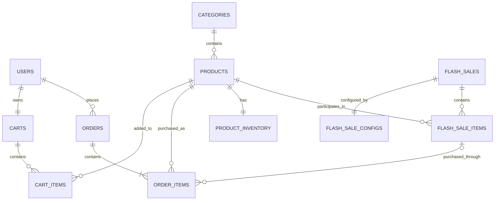

# ShopFlash Database Design

Tài liệu này mô tả thiết kế dữ liệu **nền chung** của **ShopFlash**, đã hiện thực trong `V1__schema.sql` và `redis/init.lua`. Module được bổ sung bảng hoặc key riêng bằng migration của mình và ghi thiết kế đó vào `AGENTS.md` của module. Trọng tâm là cách phân chia dữ liệu giữa **Oracle Database** và **Redis** để đáp ứng các business flow chính của hệ thống: quản lý sản phẩm, tìm kiếm/lọc, giỏ hàng, đặt hàng, báo cáo/thống kê và Flash Sale.

Thiết kế theo nguyên tắc:

- **Oracle** là **source of truth** cho dữ liệu nghiệp vụ lâu dài và dữ liệu cần tính nhất quán cao.
- **Redis** được dùng cho các workload phù hợp với đặc tính in-memory như search projection, Flash Sale runtime state, reservation và analytics read model.
- Redis không thay thế Oracle cho các business entity cốt lõi.

---

## 1. Kiến trúc dữ liệu tổng quát

```text
                         ShopFlash
                            │
                    Spring Boot Backend
                            │
             ┌──────────────┴──────────────┐
             │                             │
          Oracle                         Redis
             │                             │
   Business Source of Truth       Runtime / Read Model
             │                             │
   User                              Product Search
   Category                          Product Cache
   Product                           Flash Sale Runtime
   Inventory                         Reservation
   Cart                              Analytics Projection
   Order
   Flash Sale Config
```

### Phân chia trách nhiệm

| Loại dữ liệu | Oracle | Redis | Source of Truth |
|---|---:|---:|---|
| User | ✅ | — | Oracle |
| Category | ✅ | Projection gián tiếp qua Product | Oracle |
| Product | ✅ | Product JSON projection | Oracle |
| Inventory | ✅ | Một phần trạng thái phục vụ runtime | Oracle |
| Cart | ✅ | — | Oracle |
| Order | ✅ | Analytics projection | Oracle |
| Order Item | ✅ | Line-level analytics projection (`order:line:{id}`) | Oracle |
| Flash Sale campaign | ✅ | Runtime subset | Oracle |
| Flash Sale configuration | ✅ | Runtime subset | Oracle |
| Flash Sale item | ✅ | Runtime quota | Oracle |
| Flash Sale reservation | — | ✅ | Redis |
| Search index | — | ✅ | Derived |
| Analytics read model | — | ✅ | Derived |

---

# 2. Oracle Schema

Oracle lưu trữ toàn bộ business state chính của ShopFlash.

Các bảng core:

```text
USERS
CATEGORIES
PRODUCTS
PRODUCT_INVENTORY
CARTS
CART_ITEMS
ORDERS
ORDER_ITEMS
FLASH_SALES
FLASH_SALE_CONFIGS
FLASH_SALE_ITEMS
```

---

## 2.1. ERD logic



## 2.2. Ràng buộc và index chung

- Ràng buộc trên một dòng đặt bằng `CHECK`, để mọi đường ghi (code các module, seed, SQL gõ tay) đều bị chặn như nhau:
  - `ORDERS`: `subtotal >= 0`, `0 <= discount_amount <= subtotal`, `total_amount = subtotal - discount_amount`, `cancelled_at` có giá trị khi và chỉ khi `status = 'CANCELLED'`.
  - `ORDER_ITEMS`: `line_total = unit_price * quantity`.
  - `USERS`: `email = LOWER(email)`. Ứng dụng hạ chữ thường trước khi ghi và khi tìm, nên `uk_users_email` không phân biệt hoa thường trên thực tế.
- Mọi cột khóa ngoại đều có index bắt đầu bằng cột đó. Không có index thì xóa/sửa khóa ở bảng cha sẽ khóa cả bảng con, và join phải quét toàn bảng con. Câu kiểm tra, kết quả đúng là không có dòng nào:

```sql
SELECT c.table_name, cc.column_name, c.constraint_name
FROM   user_constraints c
JOIN   user_cons_columns cc ON cc.constraint_name = c.constraint_name
WHERE  c.constraint_type = 'R'
AND    NOT EXISTS (
         SELECT 1 FROM user_ind_columns ic
         WHERE  ic.table_name = cc.table_name
         AND    ic.column_name = cc.column_name
         AND    ic.column_position = cc.position);
```

- Index trên cột `TIMESTAMP WITH TIME ZONE` (`ix_orders_*_created`) được Oracle lưu dạng `SYS_EXTRACT_UTC(created_at)`; execution plan sẽ hiện hàm này.

---

# 3. USERS

Lưu thông tin tài khoản của Customer và Admin.

| Field | Type | Constraint | Ý nghĩa |
|---|---|---|---|
| `user_id` | `NUMBER(19)` | PK, Identity | Định danh duy nhất của người dùng |
| `email` | `VARCHAR2(255)` | NOT NULL, UNIQUE | Email dùng để đăng nhập và nhận diện tài khoản |
| `password_hash` | `VARCHAR2(255)` | NOT NULL | Mật khẩu đã được hash, không lưu plaintext |
| `full_name` | `VARCHAR2(150)` | NOT NULL | Họ tên hiển thị của người dùng |
| `phone` | `VARCHAR2(30)` | NULL | Số điện thoại liên hệ |
| `role` | `VARCHAR2(20)` | NOT NULL | Vai trò tài khoản: `CUSTOMER` hoặc `ADMIN` |
| `status` | `VARCHAR2(20)` | NOT NULL | Trạng thái tài khoản: `ACTIVE`, `DISABLED` |
| `created_at` | `TIMESTAMP WITH TIME ZONE` | NOT NULL | Thời điểm tạo tài khoản |
| `updated_at` | `TIMESTAMP WITH TIME ZONE` | NOT NULL | Thời điểm cập nhật tài khoản gần nhất |

### Index đề xuất

```text
PK_USERS(user_id)
UK_USERS_EMAIL(email)
```

---

# 4. CATEGORIES

Lưu danh mục dùng để phân loại sản phẩm.

| Field | Type | Constraint | Ý nghĩa |
|---|---|---|---|
| `category_id` | `NUMBER(19)` | PK, Identity | Định danh duy nhất của danh mục |
| `name` | `VARCHAR2(150)` | NOT NULL | Tên danh mục hiển thị cho người dùng |
| `slug` | `VARCHAR2(180)` | NOT NULL, UNIQUE | Chuỗi định danh thân thiện cho URL hoặc frontend routing |
| `description` | `VARCHAR2(1000)` | NULL | Mô tả ngắn về danh mục |
| `status` | `VARCHAR2(20)` | NOT NULL | Trạng thái sử dụng: `ACTIVE`, `INACTIVE` |
| `created_at` | `TIMESTAMP WITH TIME ZONE` | NOT NULL | Thời điểm tạo danh mục |
| `updated_at` | `TIMESTAMP WITH TIME ZONE` | NOT NULL | Thời điểm cập nhật gần nhất |

V1 không cần hỗ trợ category cha/con vì business hiện tại chưa yêu cầu phân cấp danh mục.

---

# 5. PRODUCTS

Lưu thông tin sản phẩm được bán trên ShopFlash.

| Field | Type | Constraint | Ý nghĩa |
|---|---|---|---|
| `product_id` | `NUMBER(19)` | PK, Identity | Định danh duy nhất của sản phẩm |
| `category_id` | `NUMBER(19)` | FK → `CATEGORIES.category_id`, NOT NULL | Danh mục mà sản phẩm thuộc về |
| `sku` | `VARCHAR2(80)` | NOT NULL, UNIQUE | Mã nghiệp vụ duy nhất của sản phẩm |
| `name` | `VARCHAR2(255)` | NOT NULL | Tên sản phẩm |
| `slug` | `VARCHAR2(300)` | NOT NULL, UNIQUE | Chuỗi định danh dùng cho URL hoặc routing |
| `description` | `CLOB` | NULL | Mô tả chi tiết sản phẩm |
| `base_price` | `NUMBER(15,2)` | NOT NULL | Giá bán thông thường của sản phẩm |
| `thumbnail_url` | `VARCHAR2(500)` | NULL | URL ảnh đại diện chính |
| `status` | `VARCHAR2(20)` | NOT NULL | Trạng thái bán: `ACTIVE`, `INACTIVE` |
| `created_at` | `TIMESTAMP WITH TIME ZONE` | NOT NULL | Thời điểm tạo sản phẩm |
| `updated_at` | `TIMESTAMP WITH TIME ZONE` | NOT NULL | Thời điểm cập nhật gần nhất |

### Constraint

```text
base_price >= 0
```

### Index đề xuất

```text
UK_PRODUCTS_SKU(sku)
UK_PRODUCTS_SLUG(slug)

IX_PRODUCTS_CATEGORY_STATUS(category_id, status)
IX_PRODUCTS_PRICE(base_price)
IX_PRODUCTS_NAME_UPPER(UPPER(name))
```

Product đã từng xuất hiện trong Order không nên hard-delete; thay vào đó chuyển `status = INACTIVE` để bảo toàn lịch sử.

---

# 6. PRODUCT_INVENTORY

Lưu trạng thái tồn kho hiện tại của từng sản phẩm.

Tách inventory khỏi `PRODUCTS` vì tồn kho là dữ liệu thường xuyên thay đổi và liên quan trực tiếp đến checkout, transaction và Flash Sale.

| Field | Type | Constraint | Ý nghĩa |
|---|---|---|---|
| `product_id` | `NUMBER(19)` | PK, FK → `PRODUCTS.product_id` | Sản phẩm mà inventory thuộc về |
| `on_hand_quantity` | `NUMBER(10)` | NOT NULL | Tổng số lượng vật lý còn tồn kho |
| `reserved_flash_quantity` | `NUMBER(10)` | NOT NULL | Số lượng đang được dành riêng cho các Flash Sale đang hoạt động |
| `version` | `NUMBER(10)` | NOT NULL | Giá trị version phục vụ optimistic locking hoặc concurrency experiment nếu cần |
| `updated_at` | `TIMESTAMP WITH TIME ZONE` | NOT NULL | Thời điểm inventory được cập nhật gần nhất |

### Invariant

```text
on_hand_quantity >= 0

reserved_flash_quantity >= 0

reserved_flash_quantity <= on_hand_quantity
```

Số lượng có thể bán qua checkout thông thường:

```text
normal_available
=
on_hand_quantity
-
reserved_flash_quantity
```

Ví dụ:

```text
on_hand_quantity          = 100
reserved_flash_quantity   = 30

normal_available          = 70
```

30 sản phẩm đã dành cho Flash Sale sẽ không được bán qua luồng checkout thông thường.

---

# 7. CARTS

Lưu giỏ hàng hiện tại của Customer.

Một Customer có tối đa một active cart.

| Field | Type | Constraint | Ý nghĩa |
|---|---|---|---|
| `cart_id` | `NUMBER(19)` | PK, Identity | Định danh duy nhất của giỏ hàng |
| `user_id` | `NUMBER(19)` | FK → `USERS.user_id`, NOT NULL, UNIQUE | Customer sở hữu giỏ hàng |
| `created_at` | `TIMESTAMP WITH TIME ZONE` | NOT NULL | Thời điểm giỏ hàng được tạo |
| `updated_at` | `TIMESTAMP WITH TIME ZONE` | NOT NULL | Thời điểm giỏ hàng thay đổi gần nhất |

Không lưu sẵn `total_price` hoặc `total_quantity` vì các giá trị này có thể tính từ `CART_ITEMS` và dữ liệu Product hiện tại.

---

# 8. CART_ITEMS

Lưu các sản phẩm đang nằm trong Cart.

| Field | Type | Constraint | Ý nghĩa |
|---|---|---|---|
| `cart_item_id` | `NUMBER(19)` | PK, Identity | Định danh duy nhất của một dòng trong giỏ hàng |
| `cart_id` | `NUMBER(19)` | FK → `CARTS.cart_id`, NOT NULL | Giỏ hàng chứa item |
| `product_id` | `NUMBER(19)` | FK → `PRODUCTS.product_id`, NOT NULL | Sản phẩm được thêm vào giỏ |
| `quantity` | `NUMBER(10)` | NOT NULL | Số lượng sản phẩm người dùng muốn mua |
| `created_at` | `TIMESTAMP WITH TIME ZONE` | NOT NULL | Thời điểm sản phẩm được thêm vào giỏ |
| `updated_at` | `TIMESTAMP WITH TIME ZONE` | NOT NULL | Thời điểm quantity hoặc item thay đổi gần nhất |

### Constraint

```text
quantity > 0
```

### Unique

```text
(cart_id, product_id)
```

Không lưu giá sản phẩm trong Cart. Giá phải được kiểm tra lại ở thời điểm checkout.

---

# 9. ORDERS

Lưu thông tin chung của mỗi đơn hàng.

| Field | Type | Constraint | Ý nghĩa |
|---|---|---|---|
| `order_id` | `NUMBER(19)` | PK, Identity | Định danh duy nhất của đơn hàng |
| `order_code` | `VARCHAR2(40)` | NOT NULL, UNIQUE | Mã đơn hàng dùng để hiển thị và tra cứu |
| `user_id` | `NUMBER(19)` | FK → `USERS.user_id`, NOT NULL | Customer tạo đơn hàng |
| `order_type` | `VARCHAR2(20)` | NOT NULL | Loại đơn: `NORMAL` hoặc `FLASH_SALE` |
| `status` | `VARCHAR2(20)` | NOT NULL | Trạng thái xử lý hiện tại của đơn |
| `subtotal` | `NUMBER(15,2)` | NOT NULL | Tổng giá trị các item trước giảm giá |
| `discount_amount` | `NUMBER(15,2)` | NOT NULL | Tổng số tiền giảm; mặc định 0 |
| `total_amount` | `NUMBER(15,2)` | NOT NULL | Số tiền cuối cùng của đơn |
| `recipient_name` | `VARCHAR2(150)` | NOT NULL | Tên người nhận được snapshot tại thời điểm đặt hàng |
| `recipient_phone` | `VARCHAR2(30)` | NOT NULL | Số điện thoại người nhận được snapshot |
| `shipping_address` | `VARCHAR2(500)` | NOT NULL | Địa chỉ giao hàng được snapshot |
| `idempotency_key` | `VARCHAR2(100)` | NOT NULL, UNIQUE | Khóa chống tạo trùng đơn khi client gửi lại cùng một checkout request |
| `created_at` | `TIMESTAMP WITH TIME ZONE` | NOT NULL | Thời điểm tạo đơn |
| `updated_at` | `TIMESTAMP WITH TIME ZONE` | NOT NULL | Thời điểm cập nhật đơn gần nhất |
| `cancelled_at` | `TIMESTAMP WITH TIME ZONE` | NULL | Thời điểm đơn bị hủy |

### Status V1

```text
PENDING
CONFIRMED
COMPLETED
CANCELLED
```

### Index đề xuất

```text
UK_ORDERS_CODE(order_code)
UK_ORDERS_IDEMPOTENCY(idempotency_key)

IX_ORDERS_USER_CREATED(user_id, created_at)
IX_ORDERS_STATUS_CREATED(status, created_at)
```

---

# 10. ORDER_ITEMS

Lưu snapshot các sản phẩm thực sự được mua trong một Order.

| Field | Type | Constraint | Ý nghĩa |
|---|---|---|---|
| `order_item_id` | `NUMBER(19)` | PK, Identity | Định danh duy nhất của dòng sản phẩm trong đơn |
| `order_id` | `NUMBER(19)` | FK → `ORDERS.order_id`, NOT NULL | Đơn hàng chứa item |
| `product_id` | `NUMBER(19)` | FK → `PRODUCTS.product_id`, NOT NULL | Product gốc được mua |
| `flash_sale_item_id` | `NUMBER(19)` | FK → `FLASH_SALE_ITEMS.flash_sale_item_id`, NULL | Nếu item được mua qua Flash Sale thì lưu Flash Sale item tương ứng |
| `product_name` | `VARCHAR2(255)` | NOT NULL | Snapshot tên sản phẩm tại thời điểm mua |
| `product_sku` | `VARCHAR2(80)` | NOT NULL | Snapshot SKU tại thời điểm mua |
| `unit_price` | `NUMBER(15,2)` | NOT NULL | Giá thực tế của một đơn vị sản phẩm tại thời điểm mua |
| `quantity` | `NUMBER(10)` | NOT NULL | Số lượng đã mua |
| `line_total` | `NUMBER(15,2)` | NOT NULL | Tổng giá trị của dòng: `unit_price × quantity` |

### Constraint

```text
quantity > 0
unit_price >= 0
line_total >= 0
```

Các field `product_name`, `product_sku` và `unit_price` là snapshot để lịch sử Order không bị thay đổi khi Product được chỉnh sửa sau này.

---

# 11. FLASH_SALES

Lưu thông tin chung của một Flash Sale campaign.

Ví dụ:

```text
10.10 Mega Flash Sale
```

| Field | Type | Constraint | Ý nghĩa |
|---|---|---|---|
| `flash_sale_id` | `NUMBER(19)` | PK, Identity | Định danh duy nhất của campaign |
| `name` | `VARCHAR2(200)` | NOT NULL | Tên chương trình Flash Sale |
| `description` | `VARCHAR2(1000)` | NULL | Mô tả chương trình |
| `start_at` | `TIMESTAMP WITH TIME ZONE` | NOT NULL | Thời điểm bắt đầu campaign |
| `end_at` | `TIMESTAMP WITH TIME ZONE` | NOT NULL | Thời điểm kết thúc campaign |
| `status` | `VARCHAR2(20)` | NOT NULL | Trạng thái hiện tại của campaign |
| `created_at` | `TIMESTAMP WITH TIME ZONE` | NOT NULL | Thời điểm tạo campaign |
| `updated_at` | `TIMESTAMP WITH TIME ZONE` | NOT NULL | Thời điểm cập nhật gần nhất |

### Status

```text
DRAFT
SCHEDULED
ACTIVE
ENDED
CANCELLED
```

### Constraint

```text
end_at > start_at
```

---

# 12. FLASH_SALE_CONFIGS

Lưu policy chung áp dụng cho toàn bộ Flash Sale campaign.

Quan hệ:

```text
FLASH_SALES 1 ─── 1 FLASH_SALE_CONFIGS
```

| Field | Type | Constraint | Ý nghĩa |
|---|---|---|---|
| `flash_sale_id` | `NUMBER(19)` | PK, FK → `FLASH_SALES.flash_sale_id` | Campaign mà configuration thuộc về |
| `max_quantity_per_user` | `NUMBER(10)` | NOT NULL | Số lượng tối đa một Customer được mua cho mỗi Flash Sale item |
| `reservation_timeout_seconds` | `NUMBER(10)` | NOT NULL | Số giây một reservation có hiệu lực trước khi tự hết hạn |
| `allow_cancel` | `CHAR(1)` | NOT NULL | Cho phép hủy Flash Sale order (`Y`) hay không (`N`) |
| `created_at` | `TIMESTAMP WITH TIME ZONE` | NOT NULL | Thời điểm configuration được tạo |
| `updated_at` | `TIMESTAMP WITH TIME ZONE` | NOT NULL | Thời điểm configuration được cập nhật |

### Giá trị mặc định đề xuất

```text
max_quantity_per_user       = 1
reservation_timeout_seconds = 60
allow_cancel                = N
```

---

# 13. FLASH_SALE_ITEMS

Lưu từng Product tham gia một Flash Sale campaign.

| Field | Type | Constraint | Ý nghĩa |
|---|---|---|---|
| `flash_sale_item_id` | `NUMBER(19)` | PK, Identity | Định danh duy nhất của product trong campaign |
| `flash_sale_id` | `NUMBER(19)` | FK → `FLASH_SALES.flash_sale_id`, NOT NULL | Campaign chứa product |
| `product_id` | `NUMBER(19)` | FK → `PRODUCTS.product_id`, NOT NULL | Product được đưa vào Flash Sale |
| `sale_price` | `NUMBER(15,2)` | NOT NULL | Giá bán trong Flash Sale |
| `allocated_quantity` | `NUMBER(10)` | NOT NULL | Tổng số lượng được dành riêng cho item trong campaign |
| `sold_quantity` | `NUMBER(10)` | NOT NULL | Số lượng đã mua thành công |
| `status` | `VARCHAR2(20)` | NOT NULL | Trạng thái item: `ACTIVE`, `INACTIVE` |
| `created_at` | `TIMESTAMP WITH TIME ZONE` | NOT NULL | Thời điểm item được thêm vào campaign |
| `updated_at` | `TIMESTAMP WITH TIME ZONE` | NOT NULL | Thời điểm item được cập nhật gần nhất |

### Unique

```text
(flash_sale_id, product_id)
```

### Constraint

```text
sale_price >= 0

allocated_quantity > 0

sold_quantity >= 0

sold_quantity <= allocated_quantity
```

---

# 14. Inventory và Flash Sale

Ví dụ Product có:

```text
on_hand_quantity        = 100
reserved_flash_quantity = 0
```

Flash Sale phân bổ:

```text
allocated_quantity = 30
```

Khi lượng hàng được dành cho Flash Sale:

```text
on_hand_quantity        = 100
reserved_flash_quantity = 30
```

Checkout thông thường chỉ được sử dụng:

```text
100 - 30 = 70
```

## Flash Sale bán thành công 1 sản phẩm

Oracle:

```text
on_hand_quantity:
100 → 99

reserved_flash_quantity:
30 → 29

FLASH_SALE_ITEMS.sold_quantity:
0 → 1
```

Redis:

```text
remaining:
30 → 29
```

## Flash Sale kết thúc còn hàng

Ví dụ còn 10 item chưa bán:

```text
reserved_flash_quantity:
10 → 0
```

`on_hand_quantity` không thay đổi.

10 sản phẩm còn lại quay trở lại pool bán thông thường.

## Bất biến và người chịu trách nhiệm

```text
reserved_flash_quantity = Σ (allocated_quantity - sold_quantity)
                          của các FLASH_SALE_ITEMS ACTIVE thuộc FLASH_SALES ACTIVE
```

Bất biến trải trên ba bảng nên `CHECK` không ép được. Không dùng trigger: trigger trên `FLASH_SALE_ITEMS` khóa thêm dòng đúng lúc tranh mua và dễ gặp lỗi mutating table.

- Module `concurrency` giữ bất biến trong cùng transaction với thao tác thay đổi `FLASH_SALE_ITEMS` hoặc trạng thái Flash Sale.
- View `v_inventory_invariant_check` liệt kê sản phẩm đang lệch (`reserved_flash_quantity`, `expected_reserved`). Kết quả đúng là không có dòng nào; dùng trong kiểm thử và demo.
- Nếu module `concurrency` quyết định giữ suất từ lúc `SCHEDULED` thì sửa điều kiện trạng thái trong view bằng migration của module.

---

# 15. Normal Checkout Flow

Cart được quản lý hoàn toàn trong Oracle.

```text
CARTS
  │
CART_ITEMS
  │
  ▼
Checkout
  │
  ▼
BEGIN Oracle Transaction
  │
  ├── Load CartItems
  ├── Lock ProductInventory
  ├── Validate Product status
  ├── Validate available quantity
  ├── Recalculate current price
  ├── INSERT Order
  ├── INSERT OrderItems
  ├── UPDATE ProductInventory
  ├── DELETE CartItems
  │
  └── COMMIT
```

Nếu một bước thất bại:

```text
ROLLBACK
```

Cart và toàn bộ dữ liệu liên quan vẫn giữ trạng thái trước transaction.

Số lượng khả dụng cho normal checkout:

```text
normal_available
=
on_hand_quantity
-
reserved_flash_quantity
```

---

# 16. Order Cancellation

V1 đề xuất:

```text
PENDING → có thể CANCEL
CONFIRMED / COMPLETED / CANCELLED → không cancel trực tiếp
```

Với Order thường:

```text
BEGIN

Order.status → CANCELLED

restore ProductInventory

COMMIT
```

Với Flash Sale order, chính sách hủy được quyết định bằng:

```text
FLASH_SALE_CONFIGS.allow_cancel
```

V1 mặc định:

```text
allow_cancel = N
```

---

# 17. Redis Data Model

Redis được dùng cho ba nhóm workload chính:

```text
Redis
│
├── Product Search / Read Model
│
├── Flash Sale Runtime
│
└── Analytics Read Model
```

---

# 18. Product Search Projection

## Key

```text
product:{productId}
```

## Type

```text
JSON
```

Ví dụ:

```json
{
  "id": 101,
  "sku": "IP16-128",
  "name": "iPhone 16 128GB",
  "categoryId": 5,
  "categoryName": "Smartphone",
  "price": 19990000,
  "status": "ACTIVE",
  "inStock": true,
  "thumbnailUrl": "/images/iphone16.jpg"
}
```

### Ý nghĩa các field

| Field | Ý nghĩa |
|---|---|
| `id` | ID Product trong Oracle |
| `sku` | Mã sản phẩm dùng cho nhận diện và search chính xác |
| `name` | Tên sản phẩm dùng cho full-text search |
| `categoryId` | ID danh mục phục vụ filter |
| `categoryName` | Tên danh mục phục vụ hiển thị hoặc filter |
| `price` | Giá hiện tại phục vụ filter và sort |
| `status` | Trạng thái Product |
| `inStock` | Product hiện còn khả năng bán hay không |
| `thumbnailUrl` | Ảnh đại diện phục vụ Product Listing |

Đây là **projection từ Oracle**, không phải nguồn dữ liệu chính.

---

# 19. Product Search Index

## Index

```text
idx:products
```

Prefix:

```text
product:
```

Các field đề xuất:

| JSON Field | RediSearch Type | Ý nghĩa |
|---|---|---|
| `name` | `TEXT` | Full-text search tên sản phẩm |
| `sku` | `TAG` | Tìm kiếm chính xác SKU |
| `categoryId` | `NUMERIC` hoặc `TAG` | Filter theo danh mục |
| `categoryName` | `TAG` | Filter hoặc facet theo tên danh mục |
| `price` | `NUMERIC SORTABLE` | Filter khoảng giá và sort |
| `status` | `TAG` | Chỉ lấy Product đang active |
| `inStock` | `TAG` | Filter Product còn hàng |

Phục vụ các workload:

```text
Search by name
Filter by category
Filter by price
Filter active products
Filter in-stock products
Sort by price
```

---

# 20. Flash Sale Runtime Config

Khi campaign chuẩn bị chạy, backend load dữ liệu cần thiết từ Oracle sang Redis.

## Key

```text
flash:sale:{saleId}
```

## Type

```text
HASH
```

Ví dụ:

```text
status          ACTIVE
startAt         1791280800
endAt           1791284400
maxPerUser      1
reservationTTL  60
allowCancel     0
```

### Ý nghĩa

| Field | Ý nghĩa |
|---|---|
| `status` | Trạng thái runtime của campaign |
| `startAt` | Epoch timestamp thời điểm campaign bắt đầu |
| `endAt` | Epoch timestamp thời điểm campaign kết thúc |
| `maxPerUser` | Số lượng tối đa mỗi user được mua cho một item |
| `reservationTTL` | Thời gian reservation tồn tại |
| `allowCancel` | Chính sách cho phép hủy Flash Sale order |

Nguồn dữ liệu gốc:

```text
FLASH_SALES
+
FLASH_SALE_CONFIGS
```

trong Oracle.

---

# 21. Flash Sale Item Runtime

## Key

```text
flash:item:{flashSaleItemId}
```

## Type

```text
HASH
```

Ví dụ:

```text
saleId      10
productId   101
remaining   100
status      ACTIVE
```

### Ý nghĩa

| Field | Ý nghĩa |
|---|---|
| `saleId` | ID Flash Sale campaign trong Oracle |
| `productId` | Product tương ứng |
| `remaining` | Quota còn lại có thể được reserve trong runtime |
| `status` | Item hiện có được phép mua hay không |

Khi sale bắt đầu:

```text
remaining
=
allocated_quantity
-
sold_quantity
```

Oracle giữ durable value; Redis chịu concurrent decrement trong thời gian sale hoạt động.

---

# 22. User Purchase Counter

Dùng để enforce `max_quantity_per_user`.

## Key

```text
flash:item:{itemId}:user_qty
```

## Type

```text
HASH
```

Ví dụ:

```text
42 → 1
51 → 1
70 → 2
```

Trong đó:

```text
field = userId
value = số lượng user đã reserve/mua trong Flash Sale item
```

Lua script kiểm tra:

```text
current_user_quantity + requested_quantity
<=
max_quantity_per_user
```

trước khi tạo reservation.

---

# 23. Flash Sale Reservation

Reservation là trạng thái tạm giữa bước giữ quota trên Redis và bước commit Order trong Oracle.

## Key

```text
flash:reservation:{reservationId}
```

## Type

```text
HASH
```

Các field:

| Field | Ý nghĩa |
|---|---|
| `saleItemId` | Flash Sale item được reserve |
| `userId` | Customer thực hiện mua |
| `quantity` | Số lượng đang được giữ |
| `status` | Trạng thái reservation, ví dụ `PENDING` |
| `createdAt` | Thời điểm tạo reservation |
| `expiresAt` | Thời điểm reservation hết hạn |

---

# 24. Reservation Expiry Index

## Key

```text
flash:reservations:expiry
```

## Type

```text
ZSET
```

Cấu trúc:

```text
score  = expiresAt
member = reservationId
```

Mục đích:

- tìm nhanh các reservation đã hết hạn;
- hoàn lại quota khi request bị bỏ dở;
- xử lý trường hợp backend crash giữa Redis và Oracle transaction.

---

# 25. Flash Sale Purchase Flow

```text
Customer Buy
     │
     ▼
Redis Lua
     │
     ├── campaign active?
     ├── item active?
     ├── remaining >= quantity?
     ├── user quantity <= limit?
     │
     ├── remaining -= quantity
     ├── userQty += quantity
     └── create reservation
             │
             ▼
        Oracle Transaction
             │
             ├── INSERT Order
             ├── INSERT OrderItem
             ├── UPDATE ProductInventory
             └── UPDATE FlashSaleItem
             │
        ┌────┴────┐
     COMMIT     ROLLBACK
        │           │
        ▼           ▼
   Confirm      Redis compensate
   reservation  remaining + userQty
```

## Khi Oracle commit thành công

Reservation được confirm/xóa khỏi Redis.

Quota runtime giữ nguyên vì sản phẩm đã được mua.

## Khi Oracle rollback

Redis thực hiện compensating action:

```text
remaining += quantity
userQty   -= quantity

DELETE reservation
ZREM reservation from expiry index
```

---

# 26. Backend Crash Recovery

Trường hợp:

```text
Redis reserve thành công
        ↓
Backend crash
        ↓
Oracle chưa commit
```

Reservation vẫn còn trong:

```text
flash:reservation:{reservationId}
```

và được index trong:

```text
flash:reservations:expiry
```

Cleanup process tìm reservation đã quá `expiresAt`.

Nếu reservation vẫn còn trạng thái `PENDING`:

```text
remaining += quantity
userQty   -= quantity
```

sau đó xóa reservation.

---

# 27. Analytics Read Model

Redis có thể giữ một denormalized projection để phục vụ phần Query Processing và so sánh với Oracle.

## Key

```text
order:analytics:{orderId}
```

## Type

```text
JSON
```

Ví dụ:

```json
{
  "orderId": 9001,
  "userId": 42,
  "status": "COMPLETED",
  "orderType": "NORMAL",
  "totalAmount": 22500000,
  "createdAt": 1791280800,
  "items": [
    {
      "productId": 101,
      "categoryId": 5,
      "quantity": 1,
      "lineTotal": 19990000
    }
  ]
}
```

### Ý nghĩa các field

| Field | Ý nghĩa |
|---|---|
| `orderId` | ID Order tương ứng trong Oracle |
| `userId` | Customer tạo Order |
| `status` | Trạng thái Order |
| `orderType` | Normal hoặc Flash Sale |
| `totalAmount` | Tổng giá trị cuối cùng của Order |
| `createdAt` | Thời điểm tạo đơn dưới dạng epoch |
| `items` | Danh sách item đã denormalize để tránh JOIN |
| `items.productId` | Product được mua |
| `items.categoryId` | Category của Product tại thời điểm projection |
| `items.quantity` | Số lượng mua |
| `items.lineTotal` | Giá trị của item |

`items` chỉ để xem chi tiết. Không gom nhóm trên `items[*]`: RediSearch gom nhóm trường nhiều giá trị theo giá trị đầu tiên, nên doanh thu theo category/product sẽ sai. Thống kê theo dòng hàng dùng projection ở §27.1.

## 27.1. Order Line Projection

Key:

```text
order:line:{orderItemId}
```

Type `JSON`, một document cho mỗi Order Item:

```json
{
  "orderId": 9001,
  "userId": 42,
  "status": "COMPLETED",
  "orderType": "NORMAL",
  "createdAt": 1791280800,
  "productId": 101,
  "categoryId": 5,
  "quantity": 1,
  "lineTotal": 19990000
}
```

Prefix là `order:line:`, không phải `order:analytics:item:`: mọi key bắt đầu bằng `order:analytics:` đều bị `idx:order-analytics` index, document dòng hàng sẽ làm sai số đơn.

Module được thêm field không index (ví dụ `productName`, `categoryName`) để đọc kèm khi aggregate.

Oracle giữ dữ liệu normalized:

```text
ORDERS
ORDER_ITEMS
PRODUCTS
CATEGORIES
```

Redis giữ read model denormalized để phục vụ experiment/query.

---

# 28. Analytics Index

## Key

```text
idx:order-analytics
```

Type:

```text
RediSearch Index
```

Index gồm:

| Field | Mục đích |
|---|---|
| `userId` | Filter hoặc aggregate theo Customer |
| `status` | Chỉ thống kê các Order hợp lệ |
| `orderType` | So sánh Normal và Flash Sale |
| `totalAmount` | Aggregate doanh thu |
| `createdAt` | Filter theo khoảng thời gian |
| `items[*].productId` (`itemProductId`) | Chỉ để lọc đơn có chứa Product; không dùng để gom nhóm |

## 28.1. Order Line Analytics Index

```text
idx:order-line-analytics   ON JSON   PREFIX order:line:
```

| Field | Kiểu | Mục đích |
|---|---|---|
| `orderId`, `userId` | NUMERIC | Lọc, gom nhóm theo đơn/khách |
| `status`, `orderType` | TAG | Chỉ tính đơn hợp lệ; so sánh Normal và Flash Sale |
| `createdAt` | NUMERIC SORTABLE | Lọc theo khoảng thời gian |
| `productId`, `categoryId` | NUMERIC | Gom nhóm theo Product/Category |
| `quantity`, `lineTotal` | NUMERIC | Tổng số lượng, doanh thu |

Ví dụ doanh thu theo category:

```text
FT.AGGREGATE idx:order-line-analytics "@status:{CONFIRMED|COMPLETED}"
  GROUPBY 1 @categoryId REDUCE SUM 1 @lineTotal AS revenue
```

---

# 29. Redis Schema Tổng Hợp

| Key Pattern | Type | Vai trò |
|---|---|---|
| `product:{productId}` | JSON | Product read/search projection |
| `idx:products` | Search Index | Search, filter, sort Product |
| `flash:sale:{saleId}` | HASH | Runtime campaign/config |
| `flash:item:{itemId}` | HASH | Runtime quota của Flash Sale item |
| `flash:item:{itemId}:user_qty` | HASH | Theo dõi giới hạn mua từng user |
| `flash:reservation:{id}` | HASH | Reservation tạm |
| `flash:reservations:expiry` | ZSET | Theo dõi reservation timeout |
| `order:analytics:{orderId}` | JSON | Denormalized analytics projection theo đơn |
| `idx:order-analytics` | Search Index | Query và aggregate theo đơn |
| `order:line:{orderItemId}` | JSON | Analytics projection theo dòng hàng |
| `idx:order-line-analytics` | Search Index | Aggregate theo Product/Category |

---

# 30. Đồng bộ Oracle → Redis

Không sử dụng distributed transaction/XA giữa Oracle và Redis.

Với Product:

```text
Oracle UPDATE Product
        ↓
COMMIT
        ↓
Update product:{id} in Redis
```

Nếu cập nhật Redis thất bại:

```text
Oracle vẫn là source of truth
```

Product projection có thể được rebuild lại.

Tương tự với Order Analytics:

```text
Oracle Order COMMIT
        ↓
Build order:analytics:{orderId} và order:line:{orderItemId}
        ↓
Update Redis analytics projection
```

Redis read model có thể sử dụng eventual consistency vì đây không phải dữ liệu nghiệp vụ gốc.

---

# 31. Mapping Feature → Data Model

| Feature | Oracle | Redis |
|---|---|---|
| **F1 – Category Management** | `CATEGORIES` | Product projection gián tiếp |
| **F2 – Product Management** | `PRODUCTS`, `PRODUCT_INVENTORY` | `product:{id}` |
| **F3 – Product Search** | `PRODUCTS`, `CATEGORIES` | `idx:products` |
| **F4 – Filter & Sort** | Product indexes | `idx:products` |
| **F5 – Sales Reports** | `ORDERS`, `ORDER_ITEMS` | `order:analytics:{id}`, `order:line:{id}` |
| **F6 – Business Statistics** | `USERS`, `ORDERS`, `ORDER_ITEMS`, `PRODUCTS` | Analytics projection/index |
| **F7 – Checkout** | `CARTS`, `CART_ITEMS`, `ORDERS`, `ORDER_ITEMS`, `PRODUCT_INVENTORY` | — |
| **F8 – Order Management** | `ORDERS`, `ORDER_ITEMS` | Optional analytics projection |
| **F9 – Flash Sale** | `FLASH_SALES`, `FLASH_SALE_CONFIGS`, `FLASH_SALE_ITEMS`, `PRODUCT_INVENTORY`, `ORDERS`, `ORDER_ITEMS` | Flash runtime + reservation |
| **F10 – Cart** | `CARTS`, `CART_ITEMS` | — |

---

# 32. Assignment Query Requirements

Thiết kế trên đáp ứng các loại thao tác/query cần có trong application:

| Requirement | Ví dụ |
|---|---|
| **INSERT** | Tạo Category, Product, Order, Flash Sale |
| **DELETE** | Xóa Category/Product chưa được tham chiếu; xóa Cart Item |
| **UPDATE** | Product, Inventory, Order, Cart Item, Flash Sale |
| **Query – single condition** | Tìm Order theo user hoặc Product theo category |
| **Query – composite condition** | Product active + category + price range |
| **JOIN** | Order + OrderItem + Product + User |
| **Subquery** | Product có doanh số cao hơn trung bình |
| **Aggregate** | Revenue, total orders, total quantity sold, bestseller |

---

# 33. Schema Tổng Thể

## Oracle

```text
USERS
│
├── CARTS
│    └── CART_ITEMS ───────── PRODUCTS
│
└── ORDERS
     └── ORDER_ITEMS ──────── PRODUCTS
                   │
                   └── FLASH_SALE_ITEMS


CATEGORIES
    │
    └── PRODUCTS
          │
          └── PRODUCT_INVENTORY


FLASH_SALES
    │
    ├── FLASH_SALE_CONFIGS
    │
    └── FLASH_SALE_ITEMS ─── PRODUCTS
```

## Redis

```text
Redis
│
├── Product Search
│    ├── product:{productId}
│    └── idx:products
│
├── Flash Sale Runtime
│    ├── flash:sale:{saleId}
│    ├── flash:item:{itemId}
│    ├── flash:item:{itemId}:user_qty
│    ├── flash:reservation:{id}
│    └── flash:reservations:expiry
│
└── Analytics
     ├── order:analytics:{orderId}
     └── idx:order-analytics
```

Thiết kế này giữ Oracle làm application database chính, trong khi Redis được sử dụng cho những workload mà nó có lợi thế rõ ràng: search/read projection, concurrent Flash Sale runtime state, reservation và denormalized analytics.
