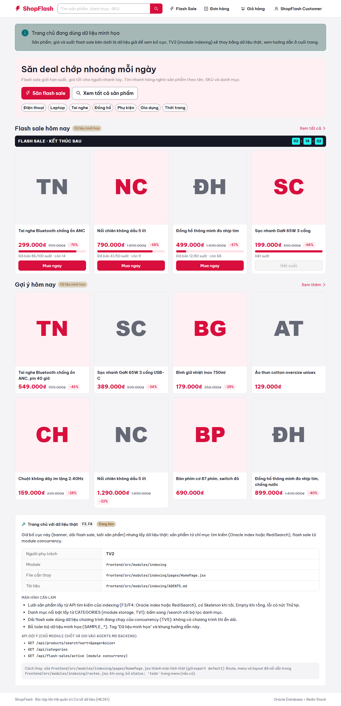
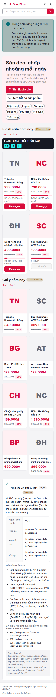
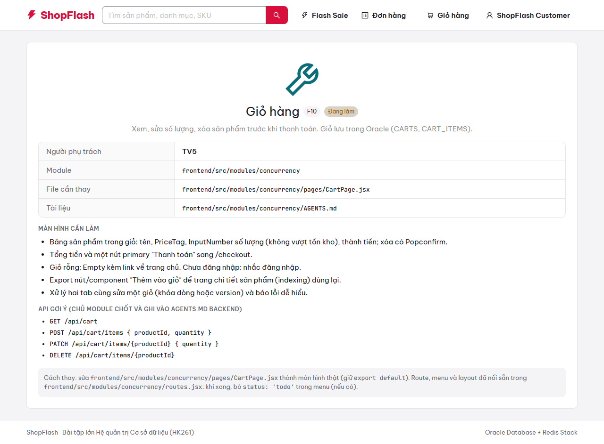
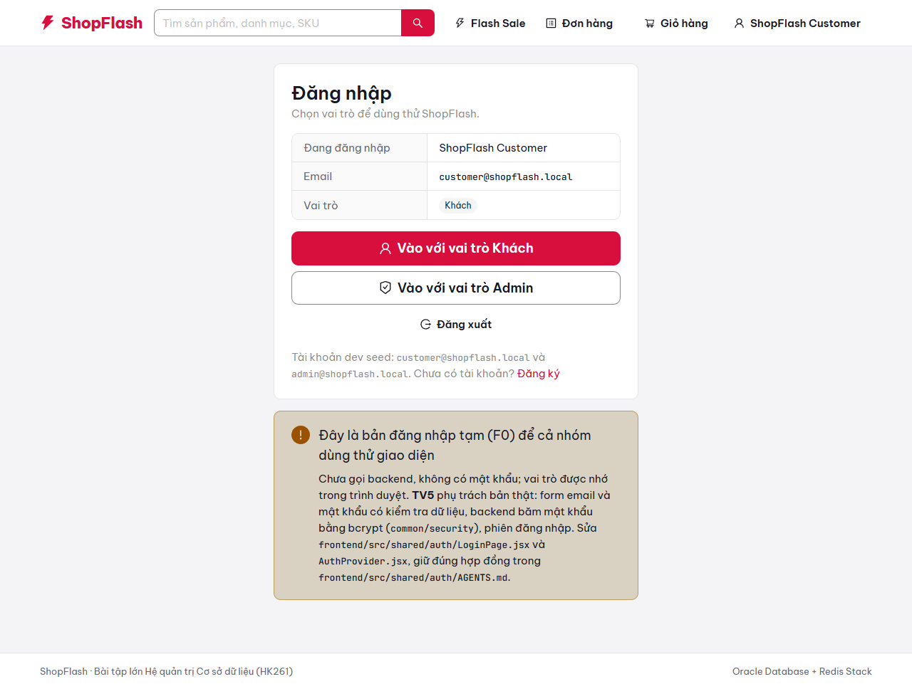
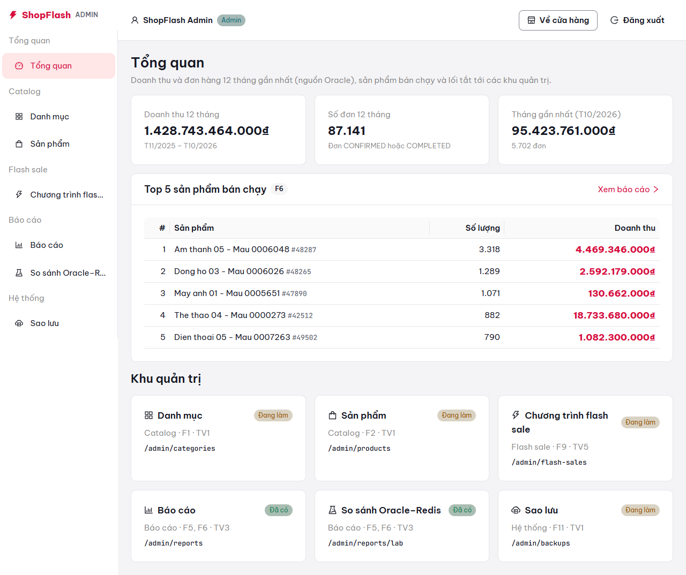
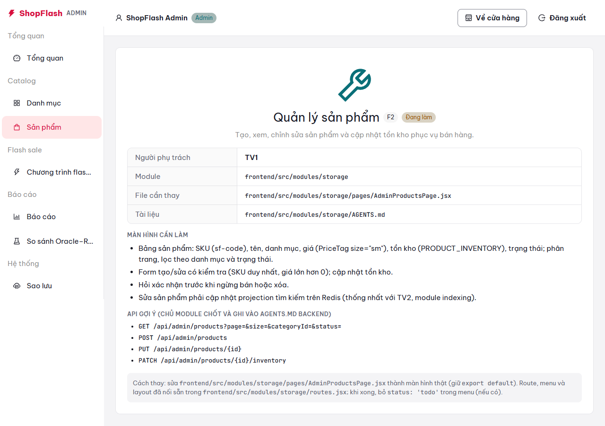
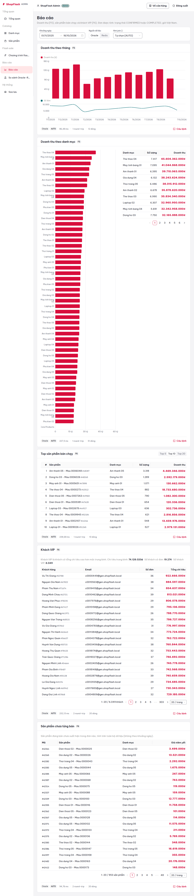
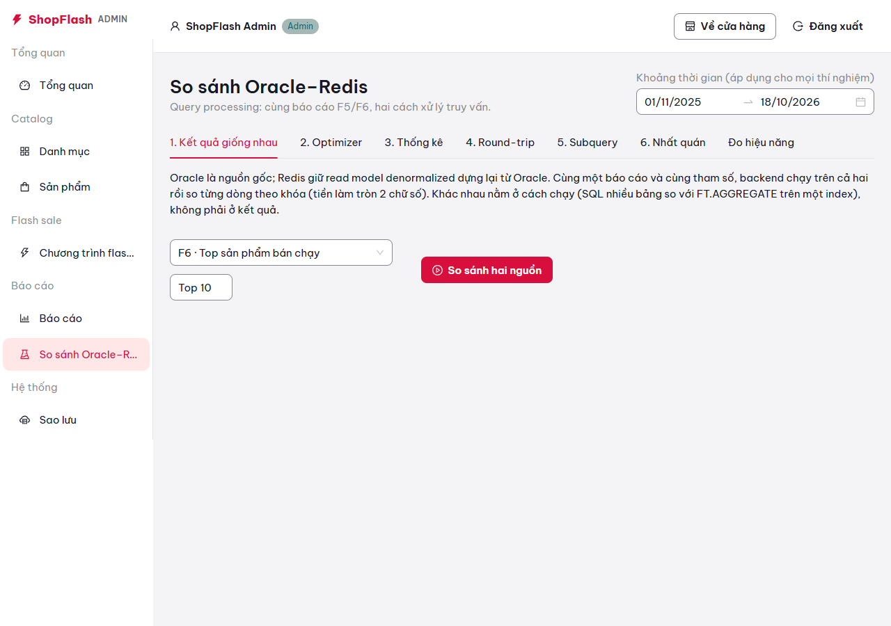

# Hướng dẫn sử dụng ShopFlash

ShopFlash là cửa hàng trực tuyến có flash sale, dùng để so sánh Oracle và Redis trong môn Hệ quản trị CSDL. Tài liệu này hướng dẫn mở app và đi qua các màn hình. Cách cài đặt và code: [`HUONG_DAN_DEV.md`](HUONG_DAN_DEV.md).

## 1. Mở app

Ở thư mục gốc repo:

- **Windows:** `powershell -ExecutionPolicy Bypass -File scripts\dev.ps1`
- **macOS / Linux:** `scripts/dev.sh`

Chờ khoảng 1–3 phút, trình duyệt sẽ tự mở http://localhost:5173.

Chỉ muốn xem giao diện, không cần database: `scripts\dev.ps1 -Mock`. Khi đó trang báo cáo dùng dữ liệu mẫu; các trang khác vẫn mở được bình thường.

## 2. Hai loại màn hình

| Ký hiệu trên màn hình | Ý nghĩa |
|---|---|
| Không có ký hiệu gì | Màn hình đã làm xong, dùng dữ liệu thật từ Oracle/Redis |
| Nhãn **"Dữ liệu minh họa"** | Bố cục đã có nhưng số liệu là giả, để xem trước giao diện |
| Thẻ **"Đang làm"** (biểu tượng cờ lê) | Thành viên phụ trách đang làm. Trang ghi chức năng (F1–F11), người phụ trách và việc cần làm |

Tình trạng hiện tại:
- **Đã xong:** khu Báo cáo (F5, F6) và trang Tổng quan quản trị.
- **Đang làm:** các màn hình còn lại.
- **Đăng nhập (F0):** đang là bản tạm.

## 3. Cửa hàng (khách hàng)

Đầu trang:

| Thành phần | Dùng để |
|---|---|
| Logo **ShopFlash** | Về trang chủ |
| Ô tìm kiếm | Gõ tên, danh mục hoặc SKU rồi Enter để sang trang kết quả `/search` |
| **Flash Sale** | Chương trình giảm giá giới hạn suất (F9) |
| **Đơn hàng** | Đơn hàng của tôi (F8) |
| **Giỏ hàng** | Giỏ hàng (F10), từ đó sang thanh toán (F7) |
| Tên tài khoản | Đăng nhập/đăng xuất; tài khoản admin có thêm mục "Trang quản trị" |

Trên điện thoại, các mục này nằm trong nút menu (☰) ở góc trên.

Ví dụ một màn hình đang làm:

## 4. Đăng nhập (bản tạm)

Đăng nhập thật (F0) do TV5 làm. Trong lúc chờ, trang `/login` có hai nút:

| Nút | Vào với tài khoản | Dùng được |
|---|---|---|
| **Vào với vai trò Khách** | `customer@shopflash.local` | Cửa hàng |
| **Vào với vai trò Admin** | `admin@shopflash.local` | Cửa hàng và trang quản trị |

Mở trang quản trị khi chưa đăng nhập, hoặc đang là khách, app sẽ đưa về trang đăng nhập rồi quay lại đúng trang đang mở.

## 5. Trang quản trị

Vào http://localhost:5173/admin (hoặc menu tài khoản, chọn "Trang quản trị"). Menu bên trái chia nhóm: Tổng quan, Catalog, Flash sale, Báo cáo, Hệ thống. "Về cửa hàng" ở góc phải để quay lại cửa hàng.

### Tổng quan

- **Ba ô số:** doanh thu 12 tháng, số đơn, tháng gần nhất. Chỉ tính đơn đã xác nhận hoặc hoàn tất.
- **Top 5 sản phẩm bán chạy:** bấm "Xem báo cáo" để xem đầy đủ.
- **Khu quản trị:** mỗi thẻ là một khu, có người phụ trách và trạng thái "Đã có" / "Đang làm".

Ví dụ khu đang làm:

### Báo cáo (F5, F6)

1. **Chọn khoảng ngày** ở thanh trên cùng; mặc định là 12 tháng gần nhất.
2. **Chọn nguồn dữ liệu:**
   - **Oracle:** truy vấn SQL trên các bảng gốc.
   - **Redis:** truy vấn read model đã dựng sẵn.
3. **Tùy chọn nâng cao:**
   - Oracle: **Hint join** để ép cách nối bảng.
   - Redis: **AGGREGATE** (Redis tự tính) hoặc **CLIENT** (kéo dữ liệu về rồi tự tính).
4. **Các khối báo cáo:**
   - Doanh thu theo tháng
   - Doanh thu theo danh mục
   - Top sản phẩm (chọn Top 5/10/20)
   - Khách VIP (chi tiêu trên mức trung bình)
   - Sản phẩm chưa từng bán
5. **Chân mỗi khối** ghi: nguồn, thời gian chạy, số lượt gọi database (round-trip), số dòng. Nút **"Câu lệnh"** hiện đúng câu SQL hoặc lệnh Redis đã chạy.

Hai điều nên biết:
- **"Sản phẩm chưa từng bán" trên Redis báo "không hỗ trợ":** đây là cố ý, vì Redis không có phép NOT EXISTS.
- **Thời gian trên trang này không dùng để so sánh:** 5 khối chạy cùng lúc nên bị đội lên. Muốn so sánh hai database, dùng trang dưới đây.

### Query Lab

Menu **Báo cáo → Query Lab** (`/admin/reports/lab`). Khoảng ngày ở góc trên áp dụng cho mọi tab. Mỗi khối có một nút chạy; kết quả chính hiện thành hàng thẻ số (viền đỏ: Oracle, viền xanh: Redis), chi tiết ở dưới.

| Tab | Bấm gì | Thấy gì |
|---|---|---|
| Kết quả hai nguồn | So sánh hai nguồn | Oracle và Redis ra kết quả khớp từng dòng; câu SQL và lệnh Redis đặt cạnh nhau |
| Optimizer → Hint join | Chọn 2 hint, bấm Chạy và xem kế hoạch | Thời gian và kiểu join của hai hint, tỉ lệ chậm hơn, bảng kế hoạch (ước lượng/thực tế). FT.PROFILE của Redis ở cuối |
| Optimizer → Thống kê | Xem kế hoạch → Xóa thống kê → Thu thập thống kê | Mỗi nút chụp lại kế hoạch: không có thống kê thì Oracle ước lượng sai và đổi kế hoạch; thu thập lại thì trở về |
| Round-trip và subquery → Round-trip | Chạy 3 cách | Redis kéo dữ liệu về backend tự gom cần nhiều lượt gọi và chậm hơn hẳn gom trên server |
| Round-trip và subquery → Subquery | Chạy trên hai nguồn | Oracle viết subquery trong một câu; Redis phải tách lượt hoặc không làm được |
| Nhất quán | Làm mới / Dựng lại read model | Đơn mới trong Oracle: Redis chưa thấy cho tới khi dựng lại |
| Đo hiệu năng | Chọn báo cáo, số lần đo, bấm Chạy đo | Thời gian trung bình ± độ lệch, p50, p95 và biểu đồ; nút "Tải CSV" để đưa vào báo cáo |

Nút "Xóa thống kê" và "Dựng lại read model" đều hỏi xác nhận trước khi chạy. Dựng lại read model mất khoảng 20–35 giây.

## 6. Khi có lỗi

| Hiện tượng | Làm gì |
|---|---|
| Khung đỏ "Mã lỗi: NETWORK_ERROR" | Backend chưa chạy hoặc đã tắt: chạy lại `scripts\dev.ps1` |
| "REDIS_NOT_BUILT" hoặc tab Nhất quán báo "Lệch" | Query Lab, tab Nhất quán, bấm "Dựng lại read model Redis" |
| Trang trắng, máy chậm | Máy thiếu RAM: đóng bớt ứng dụng, rồi chạy lại |
| Gõ sai địa chỉ | Trang 404, bấm "Về trang chủ" |

Gặp lỗi khác: chụp màn hình khung lỗi (có mã lỗi) gửi vào nhóm.
