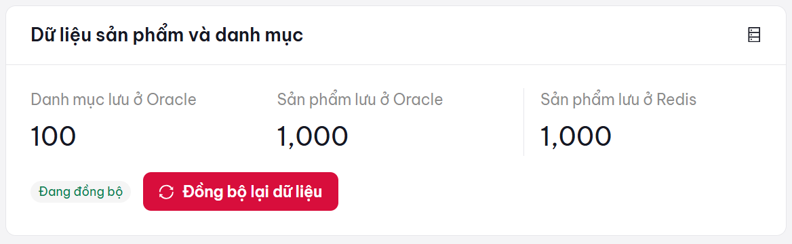
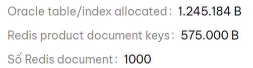
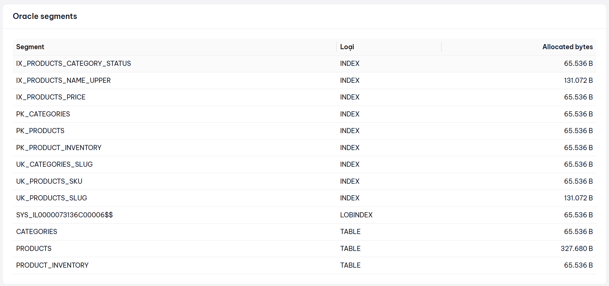

# Storage and Data Management

## 1. Objective

The Storage section examines how ShopFlash stores catalog data by combining Oracle and Redis. Its purpose is not to select a universally better database management system, but to assign the appropriate responsibility to each system:

- Oracle holds the authoritative business data, relationships, and integrity constraints.
- Redis holds JSON product projections for the read and search paths.

The design is implemented directly in the application through category management, product management, and the **Oracle--Redis Comparison** page. The experiment uses real catalog data from the application rather than a separate experimental schema.

## 2. Storage Design in ShopFlash

Oracle is the primary data source for the `CATEGORIES`, `PRODUCTS`, and `PRODUCT_INVENTORY` entities. Category and product CRUD operations go through the backend using JDBC; Oracle enforces foreign keys, unique constraints, check constraints, and transactions. The `PRODUCT_INVENTORY` table has a version column to detect concurrent inventory updates.

Redis does not store the complete relational model. After Oracle commits successfully, each Product is written as a RedisJSON document with the key `product:{id}`. The document includes `id`, `sku`, `name`, `categoryId`, `categoryName`, `price`, `status`, `inStock`, and `thumbnailUrl`. If Redis is missing data or becomes stale, the backend can rebuild the projection from Oracle.

| Component | Oracle | Redis |
|---|---|---|
| Category | A row in `CATEGORIES`; this is the source of truth. | No standalone Category document. |
| Product | A row in `PRODUCTS`; this is the source of truth. | Derived `product:{id}` document. |
| Inventory | `PRODUCT_INVENTORY`, with a version for optimistic locking. | Only the derived `inStock` field. |
| Constraints | Product--Category foreign key, unique SKU/slug, and price and inventory checks. | No declared foreign key, unique, or check constraint. |
| Synchronization | The Oracle transaction commits first. | Updated after commit; can be rebuilt from Oracle. |



*Figure 1. Storage Lab: 1,000 Products in Oracle and 1,000 product documents in Redis are synchronized.*

## 3. E1 -- Data Integrity

### Method

Storage Lab creates a test RedisJSON document with `categoryId = 999999999` and `price = -1`. These values respectively violate the Category--Product relationship and the non-negative price rule protected by Oracle.

The backend writes the document under a random `storage-lab:constraint-demo:{uuid}` key, reads it back with `JSON.GET`, then removes it with `UNLINK` within the same request. This key does not use the `product:*` prefix, is not included in the RediSearch index, does not write to Oracle, and does not change real Product data.

### Result

RedisJSON still accepts a document with a nonexistent Category and a negative price. This is a characteristic of a flexible document store, not an error. In ShopFlash, clients do not write directly to Redis: Oracle is the final constraint-validation layer, while Redis receives only projections created by the backend after Oracle data is valid.


*Figure 2. RedisJSON accepts a document with a nonexistent Category and a negative price; the test key is removed immediately afterward.*

| Rule | Oracle / source data | Redis projection |
|---|---|---|
| Category must exist | The foreign key prevents orphaned Products. | A directly written document can still contain a nonexistent `categoryId`. |
| SKU must be unique | Unique constraint and API validation. | Not responsible for validating SKU uniqueness. |
| Price must be non-negative | `CHECK (base_price >= 0)` and API validation. | A directly written document can still contain `price = -1`. |
| Inventory must be valid | Check constraint, business validation, and optimistic locking. | Holds only the derived `inStock` field. |

## 4. E2 -- Storage Footprint

### Method

The `GET /api/admin/catalog/storage-footprint` API performs two read-only measurements:

- Oracle: sums `USER_SEGMENTS.bytes` for the three catalog tables and their related indexes. This is **allocated bytes** -- space assigned to segments, rather than the exact number of bytes currently used by data.
- Redis: scans `product:*` keys and sums `MEMORY USAGE` for every key. This does not include Redis server, Docker container, or RediSearch-index overhead.

The two systems have different roles: Oracle stores source data, Inventory, and indexes; Redis stores only Product projections. Therefore, this measurement describes the operational footprint of the ShopFlash configuration; it is not a general conclusion that one DBMS always consumes less storage than the other.

### Snapshot Result

After rebuilding the dataset containing 100 Categories, 1,000 Products, and 1,000 ProductInventory rows, Oracle and Redis both contain 1,000 Products/documents and the projection is synchronized.

| System / measured scope | Storage | Bytes per Product / document |
|---|---:|---:|
| Oracle: allocated catalog tables and indexes | 1,245,184 B | 1,245.18 B |
| Redis: `product:*` RedisJSON keys | 575,000 B | 575.00 B |



*Figure 3. Footprint measurements obtained from Storage Lab.*

The three Oracle table segments occupy 458,752 B; index segments, including the Product-description LOB index, occupy 786,432 B. The difference reflects that Oracle stores source data together with structures supporting integrity and queries, while Redis stores only a read-path projection.



*Figure 4. Oracle table and index segments included in the E2 measurement.*

## 5. Rebuild Data and Measure Again

```text
storage/
├── images/                    Storage Lab evidence images
├── seed/                      Manually executed Oracle dataset: 100 Categories / 1,000 Products
├── bench/measure_storage.py   Calls the Storage Lab API and saves measurements
└── results/                   Generated CSV, JSON, and Markdown results
```

### Build the Catalog Dataset

The `seed/01_seed_catalog.sql` script creates 100 Categories (`Storage Category 001` through `Storage Category 100`), 1,000 Products (SKU `STO-0001` through `STO-1000`), and one Inventory row for each Product. Inventory quantities range from 20 to 69, with no reserved quantity.

The script removes only the dataset marked with `STO-*` and `storage-category-*` before generating it again. It does not run if any Product is referenced by a Cart, Order, or Flash Sale: Oracle prevents the deletion through foreign keys and rolls back the whole transaction.

```powershell
$storageSeedContainer = docker compose ps -q oracle
docker cp report/storage/seed "${storageSeedContainer}:/tmp/storage-seed"
docker compose exec -T oracle bash -c 'printf "connect shop/%s@//localhost:1521/FREEPDB1\n@/tmp/storage-seed/01_seed_catalog.sql\nexit\n" "$SHOP_PASSWORD" | sqlplus -s -L /nolog'
curl.exe -X POST http://localhost:8080/api/admin/catalog/projection/rebuild
```

On macOS, Linux, or Git Bash on Windows, use the equivalent Bash commands below (`curl` replaces `curl.exe`):

```bash
storage_seed_container="$(docker compose ps -q oracle)"
docker cp report/storage/seed "${storage_seed_container}:/tmp/storage-seed"
docker compose exec -T oracle bash -c 'printf "connect shop/%s@//localhost:1521/FREEPDB1\n@/tmp/storage-seed/01_seed_catalog.sql\nexit\n" "$SHOP_PASSWORD" | sqlplus -s -L /nolog'
curl -X POST http://localhost:8080/api/admin/catalog/projection/rebuild
```

### Record Measurements

With the backend running and the Redis projection rebuilt, run:

```powershell
python report/storage/bench/measure_storage.py
```

The script creates three files in `results/`:

- `storage-footprint.csv`: raw data for each measurement.
- `storage-footprint.json`: the full response, including Oracle-segment details.
- `storage-footprint.md`: a snapshot table that can be used in the report.

The default is one snapshot. To collect five measurements together with E1 evidence, use:

```powershell
python report/storage/bench/measure_storage.py --runs 5 --integrity-demo
```

## 6. Conclusion

ShopFlash uses Oracle as the primary write store for Categories, Products, and Inventory because the business domain requires clear relationships, transactions, and durable constraints. Redis is suitable for product projections because it stores flexible JSON, serves the read/search path, and can be rebuilt from Oracle. In exchange, the backend is responsible for updating the projection after commit, monitoring synchronization status, and rebuilding it when Redis becomes stale.
