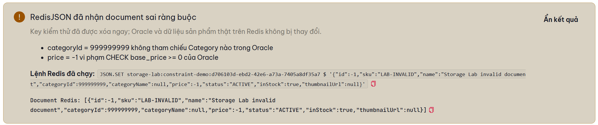

# Lưu trữ và quản lý dữ liệu

## 1. Mục tiêu

Phần Storage khảo sát cách ShopFlash lưu trữ dữ liệu catalog khi kết hợp Oracle và Redis. Mục tiêu không phải chọn một hệ quản trị cơ sở dữ liệu tốt hơn trong mọi trường hợp, mà là phân công đúng trách nhiệm cho từng hệ:

- Oracle giữ dữ liệu nghiệp vụ gốc, các quan hệ và ràng buộc toàn vẹn.
- Redis giữ product projection dạng JSON để phục vụ đường đọc và tìm kiếm.

Nội dung được hiện thực trực tiếp trong ứng dụng qua chức năng quản lý danh mục, quản lý sản phẩm và trang **So sánh Oracle--Redis**. Thí nghiệm sử dụng dữ liệu catalog thật của ứng dụng, không tạo schema thí nghiệm riêng.

## 2. Thiết kế lưu trữ trong ShopFlash

Oracle là nguồn dữ liệu chính cho ba thực thể `CATEGORIES`, `PRODUCTS` và `PRODUCT_INVENTORY`. CRUD danh mục và sản phẩm đi qua backend bằng JDBC; Oracle thực thi foreign key, unique constraint, check constraint và transaction. Bảng `PRODUCT_INVENTORY` có cột version để phát hiện cập nhật tồn kho đồng thời.

Redis không lưu lại toàn bộ mô hình quan hệ. Mỗi Product sau khi Oracle commit thành công sẽ được đưa sang một RedisJSON document có key `product:{id}`. Document gồm `id`, `sku`, `name`, `categoryId`, `categoryName`, `price`, `status`, `inStock` và `thumbnailUrl`. Nếu Redis bị thiếu hoặc stale, backend có thể dựng lại projection từ Oracle.

| Thành phần | Oracle | Redis |
|---|---|---|
| Danh mục | Dòng trong `CATEGORIES`; là dữ liệu gốc. | Không có document Category độc lập. |
| Sản phẩm | Dòng trong `PRODUCTS`; là dữ liệu gốc. | Document phái sinh `product:{id}`. |
| Tồn kho | `PRODUCT_INVENTORY`, có version cho optimistic locking. | Chỉ có `inStock` suy ra từ tồn kho Oracle. |
| Ràng buộc | Foreign key Product--Category, unique SKU/slug, check giá và tồn kho. | Không có foreign key, unique hay check constraint khai báo. |
| Đồng bộ | Transaction Oracle commit trước. | Cập nhật sau commit; có thể rebuild từ Oracle. |


*Hình 1. Storage Lab: 1.000 Product ở Oracle và 1.000 product document ở Redis đang đồng bộ.*

## 3. E1 -- Toàn vẹn dữ liệu

### Phương pháp

Storage Lab tạo một RedisJSON document kiểm thử có `categoryId = 999999999` và `price = -1`. Hai giá trị này lần lượt vi phạm quan hệ Category--Product và điều kiện giá không âm mà Oracle bảo vệ.

Backend ghi document vào key ngẫu nhiên `storage-lab:constraint-demo:{uuid}`, đọc lại bằng `JSON.GET`, rồi xóa bằng `UNLINK` trong cùng request. Key này không có prefix `product:*`, không vào RediSearch index, không ghi Oracle và không làm thay đổi dữ liệu Product thật.

### Kết quả

RedisJSON vẫn chấp nhận document có Category không tồn tại và giá âm. Đây là đặc điểm của document store linh hoạt, không phải lỗi. Trong ShopFlash, client không ghi trực tiếp vào Redis: Oracle là lớp kiểm tra ràng buộc cuối cùng, còn Redis chỉ nhận projection do backend tạo sau khi dữ liệu Oracle hợp lệ.



*Hình 2. RedisJSON nhận document có Category không tồn tại và giá âm; key kiểm thử được dọn ngay sau đó.*

| Quy tắc | Oracle / dữ liệu gốc | Redis projection |
|---|---|---|
| Category phải tồn tại | Foreign key chặn Product mồ côi. | Document ghi trực tiếp vẫn có thể chứa `categoryId` không tồn tại. |
| SKU không trùng | Unique constraint và validation API. | Không phải nơi kiểm tra unique SKU. |
| Giá không âm | `CHECK (base_price >= 0)` và validation API. | Document ghi trực tiếp vẫn có thể chứa `price = -1`. |
| Tồn kho hợp lệ | Check constraint, kiểm tra nghiệp vụ và optimistic locking. | Chỉ giữ trường `inStock` đã suy ra. |

## 4. E2 -- Footprint lưu trữ

### Phương pháp

API `GET /api/admin/catalog/storage-footprint` thực hiện hai phép đo chỉ đọc:

- Oracle: cộng `USER_SEGMENTS.bytes` của ba table catalog và index liên quan. Đây là **allocated bytes** -- không gian đã cấp phát cho segment, không phải chính xác số byte dữ liệu đang dùng.
- Redis: quét các key `product:*` và cộng `MEMORY USAGE` của từng key. Số này không gồm overhead của Redis server, Docker container hay RediSearch index.

Hai phía có vai trò khác nhau: Oracle lưu dữ liệu gốc, Inventory và index; Redis chỉ lưu projection Product. Vì vậy, phép đo chỉ mô tả footprint vận hành của cấu hình ShopFlash, không phải kết luận tổng quát rằng một DBMS luôn tốn ít dung lượng hơn DBMS còn lại.

### Kết quả snapshot

Sau khi dựng lại dữ liệu gồm 100 Category, 1.000 Product và 1.000 ProductInventory, Oracle và Redis đều có 1.000 Product/document và trạng thái projection đồng bộ.

| Hệ / phạm vi đo | Dung lượng | Bytes trên một Product / document |
|---|---:|---:|
| Oracle: table và index catalog đã cấp phát | 1.245.184 B | 1.245,18 B |
| Redis: các RedisJSON key `product:*` | 575.000 B | 575,00 B |


*Hình 3. Số liệu footprint thu được từ Storage Lab.*

Ba table segment Oracle chiếm 458.752 B; các index segment, bao gồm LOB index của mô tả Product, chiếm 786.432 B. Phần chênh lệch phản ánh việc Oracle lưu dữ liệu gốc cùng các cấu trúc phục vụ toàn vẹn và truy vấn, trong khi Redis chỉ lưu bản chiếu dùng cho đường đọc.


*Hình 4. Các table và index segment Oracle được cộng vào phép đo E2.*

## 5. Dựng lại dữ liệu và đo lại

```text
storage/
├── images/                    Ảnh minh chứng Storage Lab
├── seed/                      Dataset 100 Category / 1.000 Product chạy tay trong Oracle
├── bench/measure_storage.py   Gọi API Storage Lab và lưu số đo
└── results/                   CSV, JSON và Markdown sinh sau khi đo
```

### Dựng dataset catalog

Script `seed/01_seed_catalog.sql` tạo 100 Category (`Storage Category 001` đến `Storage Category 100`), 1.000 Product (SKU `STO-0001` đến `STO-1000`) và một dòng Inventory cho mỗi Product. Tồn kho nằm trong khoảng 20--69, không có lượng giữ chỗ.

Script chỉ xóa dataset mang nhãn `STO-*` và `storage-category-*` trước khi sinh lại. Không chạy seed nếu Product đã được Cart, Order hoặc Flash Sale tham chiếu: Oracle sẽ chặn xóa bằng foreign key và rollback toàn bộ transaction.

```powershell
$storageSeedContainer = docker compose ps -q oracle
docker cp report/storage/seed "${storageSeedContainer}:/tmp/storage-seed"
docker compose exec -T oracle bash -c 'printf "connect shop/%s@//localhost:1521/FREEPDB1\n@/tmp/storage-seed/01_seed_catalog.sql\nexit\n" "$SHOP_PASSWORD" | sqlplus -s -L /nolog'
curl.exe -X POST http://localhost:8080/api/admin/catalog/projection/rebuild
```

### Ghi lại số liệu

Khi backend đang chạy và Redis projection đã rebuild, chạy:

```powershell
python report/storage/bench/measure_storage.py
```

Script tạo ba file trong `results/`:

- `storage-footprint.csv`: số liệu thô của từng lần đo.
- `storage-footprint.json`: response đầy đủ, gồm chi tiết Oracle segment.
- `storage-footprint.md`: bảng snapshot có thể đưa vào nội dung báo cáo.

Mặc định là một snapshot. Nếu cần năm lần đo cùng bằng chứng E1, dùng:

```powershell
python report/storage/bench/measure_storage.py --runs 5 --integrity-demo
```

## 6. Kết luận

ShopFlash chọn Oracle làm nơi ghi chính cho Category, Product và Inventory vì nghiệp vụ cần quan hệ rõ ràng, transaction và ràng buộc bền vững. Redis phù hợp làm product projection do lưu JSON linh hoạt, phục vụ đường đọc/tìm kiếm và có thể dựng lại từ Oracle. Đổi lại, backend có trách nhiệm cập nhật projection sau commit, theo dõi trạng thái đồng bộ và rebuild khi Redis stale.
