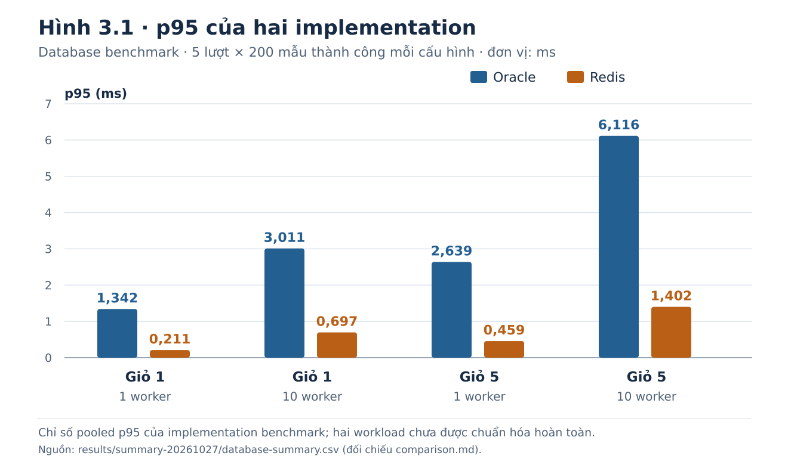

# 3. NGHIÊN CỨU VÀ SO SÁNH CƠ CHẾ TRANSACTION TRÊN ORACLE VÀ REDIS

## 3.1. Mục tiêu và phương pháp nghiên cứu

### 3.1.1. Vấn đề nghiên cứu

Trong hệ quản trị cơ sở dữ liệu (DBMS), *transaction* là đơn vị xử lý gồm một hoặc nhiều thao tác cần được kiểm soát như một công việc thống nhất. Tính đúng đắn của một transaction không chỉ phụ thuộc vào kết quả khi mọi lệnh thành công, mà còn phụ thuộc vào cách DBMS phản ứng khi một lệnh thất bại, khi các phiên truy cập đồng thời và khi hệ thống cần bảo vệ các ràng buộc dữ liệu. Các tính chất thường dùng để đánh giá là **ACID**: Atomicity (tính nguyên tử), Consistency (tính nhất quán), Isolation (tính cô lập) và Durability (tính bền vững) [1].

Oracle Database và Redis đều cung cấp cơ chế thực hiện nhiều thao tác có kiểm soát, nhưng khác nhau về mô hình dữ liệu và ngữ nghĩa giao dịch. Oracle là DBMS quan hệ, hỗ trợ transaction nhiều câu SQL, `COMMIT`, `ROLLBACK`, `SAVEPOINT`, khóa hàng và các ràng buộc toàn vẹn khai báo trong schema. Redis là hệ quản trị dữ liệu theo key và cấu trúc dữ liệu, cung cấp `MULTI/EXEC`, `DISCARD`, `WATCH` và Lua script; các cơ chế này bảo đảm việc thực thi có thứ tự hoặc phát hiện xung đột, nhưng không có phạm vi hoàn tác sau lỗi runtime tương đương Oracle [1]–[4].

Phần nghiên cứu tập trung trả lời bốn câu hỏi: (i) hai DBMS xử lý lỗi và hoàn tác các thay đổi như thế nào; (ii) chúng kiểm soát truy cập đồng thời và tranh chấp dữ liệu ra sao; (iii) ràng buộc nào được DBMS bảo vệ trực tiếp, ràng buộc nào cần logic nghiệp vụ; và (iv) hiệu năng của các implementation được đo thay đổi thế nào theo kích thước công việc và mức đồng thời. Mục tiêu là **so sánh cơ chế và kết quả kiểm chứng**, không giả định rằng hai DBMS thực hiện cùng một tập bảo đảm ACID.

### 3.1.2. Môi trường và thiết kế thực nghiệm

Thí nghiệm được chạy trên môi trường local với hai DBMS trong Docker Compose. Theo bản audit P0, Oracle sử dụng schema `SHOP` thuộc PDB `FREEPDB1` trên Oracle AI Database Free; Redis server phiên bản **7.4.7**, chế độ standalone, có bật AOF với `appendfsync everysec`. Oracle đã có migrations và các constraint được kiểm tra metadata trước khi chạy; Redis sử dụng namespace độc lập `txresearch:<run_id>:*`. Công cụ thực thi chính là **SQL/PLSQL qua SQL*Plus** và **Redis CLI/Lua**. Những script Python dùng trong các ca nhiều phiên chỉ điều phối thời điểm gửi lệnh, không thay DBMS thực hiện xử lý transaction [5].

Bộ dữ liệu thí nghiệm (*fixture*) được tạo trên schema đang sử dụng của dự án, không tạo thêm một schema Oracle mô phỏng riêng. Dữ liệu cơ sở gồm một giỏ có ba sản phẩm, tồn kho ban đầu của mỗi sản phẩm là 100 và một quota Redis giới hạn hai suất. Các ca ghi dữ liệu có setup, trạng thái trước/sau, lệnh thực hiện, output, hậu kiểm và reset/cleanup theo danh sách bản ghi hoặc key thuộc run; C1 chỉ đọc metadata nên không cần reset. B2/B4/C2 được chạy lại năm lượt trong run `rev1109b` ngày 09/11/2026; các case khác giữ evidence `native01`. Các lượt này kiểm chứng correctness, không cung cấp số đo latency/TPS. Việc cách ly dữ liệu giúp thí nghiệm có thể tái lập mà không cần xóa dữ liệu nghiệp vụ khác [5], [6].

| Lớp kiểm chứng | Phương tiện | Phạm vi kết luận |
|---|---|---|
| **DBMS-native research** | SQL/PLSQL, SQL*Plus, Redis CLI, Lua; transcript và snapshot | Quan sát ngữ nghĩa transaction, lỗi, khóa, tranh chấp và ràng buộc thực tế |
| **Database benchmark** | Java runner qua JDBC/Jedis; raw CSV/JSONL | Đo latency và throughput của **hai implementation cụ thể** trong workload đã cấu hình |
| **Application validation** | JUnit và k6/HTTP | Kiểm chứng tích hợp vào ứng dụng; không phải số đo thuần của Oracle so với Redis |

*Bảng 3.1. Ba lớp kiểm chứng được sử dụng trong nghiên cứu Transaction.*

Ba lớp trên có mục đích khác nhau. Các thí nghiệm DBMS-native được dùng làm bằng chứng chính về cơ chế; số liệu benchmark bổ trợ đánh giá hiệu năng. Ứng dụng chỉ được liên hệ ngắn ở phần kết luận để minh họa việc lựa chọn DBMS trong một ngữ cảnh cụ thể.

## 3.2. Cơ chế Transaction trong hai DBMS

### 3.2.1. Oracle Database

**Ranh giới giao dịch và rollback.** Một transaction Oracle gồm các thao tác chưa kết thúc bằng `COMMIT` hoặc `ROLLBACK`. `COMMIT` xác nhận thay đổi và làm chúng có thể được các phiên khác quan sát theo quy tắc cô lập; `ROLLBACK` hoàn tác những thay đổi chưa commit của transaction. `SAVEPOINT` cho phép quay về một mốc trung gian. Oracle còn có cơ chế *statement-level rollback*: khi một câu DML thất bại trong lúc thực thi, những thay đổi do câu đó gây ra được hoàn tác, nhưng các câu thành công trước đó trong cùng transaction không mặc nhiên bị hủy. Điều này khác với full rollback và cần được ứng dụng xử lý đúng [1], [2].

**Isolation và concurrency.** Trong chế độ `READ COMMITTED`, mỗi câu truy vấn thông thường đọc một ảnh nhất quán của dữ liệu đã commit tại thời điểm câu lệnh bắt đầu. Vì thế, hai lần `SELECT` trong cùng transaction có thể cho kết quả khác nhau nếu có transaction khác commit ở giữa. Oracle dùng undo để phục vụ khả năng đọc nhất quán; các câu ghi trên cùng hàng có thể tranh khóa. `SELECT ... FOR UPDATE` cho phép giữ khóa hàng trước bước xử lý tiếp theo, còn `WAIT`/`NOWAIT` kiểm soát cách chờ khóa. Khi phát hiện deadlock, Oracle báo lỗi cho một câu lệnh tham gia vòng chờ; việc kết thúc toàn bộ transaction và giải phóng những khóa còn giữ vẫn phải được xem xét riêng [2].

**Consistency và durability.** Các ràng buộc `PRIMARY KEY`, `FOREIGN KEY`, `UNIQUE` và `CHECK` giúp Oracle từ chối dữ liệu không hợp lệ theo schema. Tuy nhiên, DBMS không tự suy ra mọi quy tắc nghiệp vụ, ví dụ giá chốt đơn, kiểm tra quyền sở hữu giỏ hoặc số tồn có thể bán tại thời điểm mua; các quy tắc đó vẫn cần logic giao dịch. Về durability, kiến trúc Oracle sử dụng redo và cơ chế phục hồi cho những thay đổi đã commit. Bộ thực nghiệm này **không thực hiện phép thử mất nguồn/crash recovery**, vì vậy durability được phân tích ở mức cơ chế tài liệu, không được báo cáo như kết quả kiểm chứng lỗi hệ thống [1], [2].

### 3.2.2. Redis

**`MULTI/EXEC/DISCARD`.** Sau `MULTI`, các lệnh hợp lệ được xếp hàng; `EXEC` thực thi lần lượt cả hàng đợi mà không phục vụ lệnh từ client khác chen vào giữa. `DISCARD` hủy hàng đợi trước khi thực thi. Redis phân biệt lỗi khi xếp hàng (*queue-time error*) với lỗi xuất hiện khi lệnh đã được thực thi trong `EXEC` (*runtime error*). Trong trường hợp lỗi khi xếp hàng, `EXEC` có thể trả `EXECABORT` và không thực thi transaction. Ngược lại, nếu một lệnh đã xếp hàng gặp lỗi runtime, các lệnh khác vẫn có thể thực thi; Redis **không tự rollback các ghi đã thành công** [3].

**`WATCH` và Lua.** `WATCH` hỗ trợ kiểm soát xung đột lạc quan: nếu key được theo dõi thay đổi trước `EXEC`, toàn bộ hàng đợi không được thực thi và client phải đọc lại hoặc quyết định retry. Lua cho phép kiểm tra điều kiện và cập nhật nhiều key trong **một lượt thực thi không bị lệnh khác chen vào**. Tuy nhiên, *atomic execution* không đồng nghĩa với *rollback khi có lỗi*: nếu script Lua đã ghi rồi mới gặp lỗi runtime, các thay đổi trước lỗi vẫn có thể tồn tại [3], [4].

**Ràng buộc và lưu bền.** Redis Hash/key không tự áp dụng quan hệ `FOREIGN KEY` hoặc `CHECK` giữa những key như một schema quan hệ. Các quy tắc về tham chiếu sản phẩm, tồn kho không âm hay quota phải được mã hóa trong lệnh, Lua hoặc lớp ứng dụng. Cấu hình thí nghiệm sử dụng AOF `appendfsync everysec`; theo tài liệu Redis, đây là chính sách đồng bộ AOF định kỳ, không tương đương với việc đã chứng minh an toàn dữ liệu trong mọi kịch bản crash. Nghiên cứu chưa chạy phép đo mất dữ liệu hoặc khôi phục sau sự cố, nên **không kết luận mức durability thực tế của hai DBMS từ benchmark latency** [5], [7].

### 3.2.3. Đối chiếu cơ chế

| Khía cạnh | Oracle | Redis |
|---|---|---|
| Đơn vị giao dịch | Nhiều câu SQL trên các bảng trong một transaction | Hàng đợi lệnh qua `MULTI/EXEC`, hoặc một Lua script |
| Hủy trước khi thực hiện | `ROLLBACK` các thay đổi chưa commit | `DISCARD` hủy lệnh đã xếp hàng; `WATCH` có thể làm `EXEC` không chạy |
| Lỗi sau một số thao tác ghi | Có thể full rollback những thay đổi chưa commit | Không có rollback tương đương cho những ghi đã thực thi trong `EXEC`/Lua |
| Điều phối tranh chấp | Row locks, `FOR UPDATE`, conditional UPDATE, isolation level | `WATCH` phát hiện thay đổi key; Lua tuần tự hóa kiểm tra–ghi |
| Ràng buộc dữ liệu | PK/FK/UNIQUE/CHECK được khai báo ở schema | Cần tự lập trình các bất biến liên key hoặc giá trị nghiệp vụ |
| Lưu bền | COMMIT gắn với cơ chế redo/recovery của Oracle | Phụ thuộc cấu hình persistence; run này sử dụng AOF `everysec` |

*Bảng 3.2. Đối chiếu phạm vi các cơ chế Transaction của Oracle và Redis [1]–[4], [7].*

Bảng này so sánh **phạm vi bảo đảm và công cụ kiểm soát**, không xếp hạng một DBMS tốt hơn trong mọi trường hợp. Các khác biệt được kiểm chứng cụ thể ở Mục 3.3.

## 3.3. Thực nghiệm và kiểm chứng DBMS-native

### 3.3.1. Ma trận thí nghiệm

Nghiên cứu gồm **14 trường hợp**, chia thành bốn nhóm. Mỗi case có mã định danh, script và transcript; danh sách bằng chứng đầy đủ đặt tại [`research/evidence/INDEX.md`](research/evidence/INDEX.md). Trạng thái `PASS` trong hồ sơ phản ánh kết quả thực thi đã lưu và các bước đối chiếu của bộ thí nghiệm, không đồng nghĩa với việc đã kiểm thử mọi cấu hình hay mọi đường lỗi của DBMS.

| Nhóm | Case | Nội dung cần chứng minh |
|---|---|---|
| Atomicity / Rollback | A1 | Oracle `COMMIT` và full `ROLLBACK` đối với dữ liệu nhiều bảng |
| | A2 | Oracle từ chối lỗi `UNIQUE`, `FOREIGN KEY`, `CHECK` |
| | A3 | Statement rollback, rollback về savepoint và full rollback |
| | A4 | Redis `MULTI/EXEC` so với `DISCARD` |
| | A5 | Lỗi queue-time và runtime trong Redis `EXEC`/Lua |
| Isolation / Concurrency | B1 | Oracle `READ COMMITTED` giữa hai session |
| | B2 | SELECT thường so với FOR UPDATE: quyết định ưu đãi, tồn cuối đều 98 |
| | B3 | Lock timeout và deadlock trên Oracle |
| | B4 | Atomic HINCRBY và WATCH/HSET conflict, đọc lại rồi retry |
| | B5 | Lua kiểm soát nhiều client tranh quota |
| Consistency | C1 | Phạm vi PK/FK/UNIQUE/CHECK Oracle thực sự bảo vệ |
| | C2 | Guarded EVAL từ chối trước ghi; Checkout hợp lệ giữ invariant |
| Multi-step | D1 | Oracle xử lý lỗi constraint sau ghi một phần, rồi full rollback |
| | D2 | Redis Lua kiểm tra toàn bộ điều kiện trước khi ghi nhiều key |

*Bảng 3.3. Ma trận 14 thí nghiệm DBMS-native; script và transcript được liệt kê trong [chỉ mục evidence](research/evidence/INDEX.md).*

Các phân tích sau chỉ triển khai sâu những trường hợp phân biệt cơ chế rõ nhất; kết quả còn lại được tóm tắt và dẫn đến transcript, tránh lặp lại toàn bộ lệnh vận hành.

Trong các trích đoạn dưới đây, khối `sql`, `redis` hoặc `lua` ghi lệnh đã dùng; khối `text` chép nguyên văn dòng output được chọn. Chú thích bên ngoài khối nêu rõ phần lược bỏ. Mọi mã lỗi, giá trị và thứ tự sự kiện đều đối chiếu với transcript gốc, không phải kết quả chạy mới.

### 3.3.2. Atomicity, rollback và cách xử lý lỗi

**Oracle: các phạm vi hoàn tác (A3).** Trong cùng một SQL*Plus session, thí nghiệm cập nhật tồn P1 từ 100 xuống 99, tạo `SAVEPOINT before_p2`, cập nhật P2 từ 100 xuống 98, rồi cố ý đặt `CART_ITEMS.QUANTITY = 0`. Constraint `CK_CART_ITEMS_QUANTITY` phát sinh lỗi `ORA-02290`. Mặc dù câu SQL cuối bị từ chối, các cập nhật P1 và P2 trước đó vẫn còn trong transaction. Chỉ `ROLLBACK TO before_p2` mới hoàn tác cập nhật P2; full `ROLLBACK` mới đưa cả P1 về giá trị đầu kỳ [8].

```sql
  UPDATE product_inventory SET on_hand_quantity = 99, updated_at = SYSTIMESTAMP
  WHERE product_id = :p1_id;
  IF SQL%ROWCOUNT <> 1 THEN RAISE_APPLICATION_ERROR(-20051, 'Thieu Product 1'); END IF;
  SAVEPOINT before_p2;
  UPDATE product_inventory SET on_hand_quantity = 98, updated_at = SYSTIMESTAMP
  WHERE product_id = :p2_id;

    UPDATE cart_items SET quantity = 0
    WHERE cart_id = :fixture_cart_id AND product_id = :p1_id;

  ROLLBACK TO before_p2;
  ROLLBACK;
```

*Các dòng lệnh giữ nguyên nội dung và thụt lề từ [A3.sql](research/oracle/experiments/A3.sql), được rút gọn theo thứ tự chạy, không phải một khối PL/SQL độc lập. Đã lược khai báo, kiểm tra số hàng cập nhật, khối bắt exception và các truy vấn quan sát giữa những nhóm lệnh.* Output liên tiếp sau phần mở đầu SQL*Plus:

```text
STATEMENT_ERROR=-2290 ORA-02290: check constraint (SHOP.CK_CART_ITEMS_QUANTITY)
violated
AFTER_FAILED_STATEMENT P1=99 P2=98 CART_QTY=1
AFTER_ROLLBACK_TO P1=99 P2=100
AFTER_FULL_ROLLBACK P1=100 P2=100
```

*Nguồn: [transcript A3](research/evidence/p2/A3/native01-A3-output.txt); đã lược các dòng SQL*Plus báo hoàn tất PL/SQL trước và sau đoạn trích.*

> <span style="color:#087F72">■</span> **Nhận xét A3.** `ORA-02290` chỉ làm câu UPDATE Cart thất bại; P1/P2 vẫn là 99/98 trong session. `ROLLBACK TO` phục hồi P2, còn full `ROLLBACK` phục hồi cả P1.

| Mốc quan sát trong A3 | Tồn P1 | Tồn P2 | Quantity ở Cart |
|---|---:|---:|---:|
| Trước thí nghiệm | 100 | 100 | 1 |
| Sau câu SQL lỗi | 99 | 98 | 1 |
| Sau `ROLLBACK TO before_p2` | 99 | 100 | 1 |
| Sau full `ROLLBACK` | 100 | 100 | 1 |

*Bảng 3.4. Phạm vi hoàn tác trong thí nghiệm A3; đối chiếu [output gốc](research/evidence/p2/A3/native01-A3-output.txt).*

Kết quả cho thấy cần phân biệt **một câu lệnh bị hoàn tác** với **toàn transaction bị hoàn tác**. Điều này đặc biệt quan trọng ở nghiệp vụ nhiều bước: khi một bước sai, lớp điều phối phải quyết định có hủy toàn bộ công việc hay không. Ở hai thí nghiệm hỗ trợ, A1 cho thấy dữ liệu đã `COMMIT` được phiên khác quan sát, còn A2 ghi nhận các mã lỗi `ORA-00001`, `ORA-02291` và `ORA-02290` trực tiếp từ constraint có thật [8], [9].

**Redis: lỗi trước và trong khi thực thi (A4–A5).** Ở nhánh `EXEC` của A4, các lệnh tạo Order Hash, giảm tồn và xóa sản phẩm khỏi Cart được thực thi sau `MULTI`; nhánh `DISCARD` giữ nguyên snapshot. A5 cố ý gây lỗi ở những thời điểm khác nhau để làm rõ giới hạn của cơ chế này [10].

| Tình huống A5 | Phản hồi thực tế | Trạng thái sau lệnh |
|---|---|---|
| Lệnh không hợp lệ khi xếp hàng | `EXECABORT` | Không có ghi nào của transaction được thực thi |
| `LPUSH` sai kiểu dữ liệu khi `EXEC` đang chạy | `WRONGTYPE` | Tồn P1 còn **99**; Order Hash đã tạo, Cart mất P1 |
| Lua ghi tồn/Order rồi mới gọi `LPUSH` sai kiểu | `WRONGTYPE` | Tồn P1 còn **99**; Order Hash vẫn tồn tại |

*Bảng 3.5. Phân biệt lỗi trước và sau khi Redis thực thi lệnh trong A5; nguồn [output các nhánh](research/evidence/p2/A5/README.md).*

Chuỗi lệnh CLI dưới đây là những lệnh nhánh `runtime` của [A5.sh](research/redis/experiments/A5.sh) đã gửi trong **một** `redis-cli`, sau khi thế `run_id=native01`, `p1=12941` từ manifest. Các biến trong script và phần setup/reset đã được lược bỏ:

```redis
MULTI
HINCRBY txresearch:native01:inventory:12941 on_hand -1
HSET txresearch:native01:order status PENDING product_id 12941
LPUSH txresearch:native01:order impossible
HDEL txresearch:native01:cart 12941
EXEC
```

```text
MODE=runtime RUN_ID=native01
OK
QUEUED
QUEUED
QUEUED
QUEUED
99
2
WRONGTYPE Operation against a key holding the wrong kind of value

1
```

*Nguồn: [output runtime A5](research/evidence/p2/A5/native01-A5-runtime.txt), giữ cả dòng trống do `redis-cli --raw` trả về; [snapshot sau lỗi](research/evidence/p2/A5/native01-A5-runtime-after.txt) ghi tồn P1=99, Order Hash còn và Cart mất P1.* Nhánh xếp hàng lỗi ghi riêng:

```text
MODE=queue RUN_ID=native01
OK
QUEUED
ERR unknown command 'TXRESEARCH_INVALID_COMMAND', with args beginning with: 

EXECABORT Transaction discarded because of previous errors.
```

*Nguồn: [output queue-time A5](research/evidence/p2/A5/native01-A5-queue.txt); script đã gửi `TXRESEARCH_INVALID_COMMAND` trước `EXEC`.*

> <span style="color:#087F72">■</span> **Nhận xét A5.** `EXECABORT` chặn toàn bộ hàng đợi khi lệnh sai ngay lúc xếp hàng. `WRONGTYPE` phát sinh khi `EXEC` chạy; các lệnh giảm tồn và tạo Order Hash vẫn để lại thay đổi. [Lua A5](research/redis/lua/A5-error-after-write.lua) và [output lỗi Lua](research/evidence/p2/A5/native01-A5-lua.txt) cho thấy cùng giới hạn sau khi script đã ghi.

Redis vẫn bảo đảm các lệnh của `EXEC` được xử lý tuần tự không bị client khác chen vào; hiện tượng quan sát được là **thiếu cơ chế full rollback sau lỗi runtime**, không phải phủ nhận hoàn toàn tính nguyên tử của Redis. Đây là khác biệt nền tảng về *rollback semantics* giữa hai DBMS [3], [10].

### 3.3.3. Isolation, xung đột và kiểm soát đồng thời

**Khả năng nhìn thấy dữ liệu trên Oracle (B1).** Hai session độc lập được giữ liên tục ở `READ COMMITTED`. Session B lần đầu đọc tồn kho P1 bằng 100. Sau khi A cập nhật xuống 99 nhưng chưa `COMMIT`, B vẫn đọc 100. Khi A commit, câu `SELECT` mới của B đọc 99 dù B đang ở cùng transaction. Trình tự **100 → 100 → 99** xác nhận B không đọc dữ liệu chưa commit và mỗi câu SELECT trong chế độ này có thể dùng một ảnh nhất quán mới [11].

**Oracle READ COMMITTED và khóa trước khi đọc (B2).** Quy tắc mô phỏng: chỉ lượt mua quan sát Stock=100 tại thời điểm quyết định đủ điều kiện ưu đãi. Hai nhánh cùng dùng `UPDATE product_inventory SET on_hand_quantity=on_hand_quantity-1 WHERE product_id=:p1`, cùng READ COMMITTED và stock đầu 100.

| Nhánh | A đọc / ưu đãi | B đọc / ưu đãi | Điểm B chờ | Tồn sau hai COMMIT |
|---|---|---|---|---:|
| B2.1 SELECT thông thường | 100 / có | 100 / có | UPDATE cùng row sau khi A UPDATE chưa commit | 98 |
| B2.2 SELECT FOR UPDATE WAIT 30 | 100 / có | 99 / không | SELECT FOR UPDATE trước A UPDATE/COMMIT | 98 |

B2.1 không khóa khi đọc, nhưng UPDATE vẫn tự động lấy row lock. A đã thực hiện UPDATE trước COMMIT; B SELECT thông thường thấy phiên bản committed 100. B UPDATE phải chờ A COMMIT rồi giảm từ giá trị hiện tại, nên cả hai lần giảm được giữ. B2.2 khóa trước khi quyết định: B chỉ đọc 99 sau khi A giảm tồn và COMMIT. Khác biệt nằm ở quyết định ưu đãi, không phải lost update hay overselling. COMMIT xác nhận thay đổi và quyết định khả năng nhìn thấy từ session khác, không phải lúc UPDATE mới được thực thi.

[Hồ sơ B2](research/evidence/p3/B2/README.md) và [timeline mới](research/evidence/revision-20261109/1-B2.txt) ghi các mốc đọc, quyết định, chờ, UPDATE, COMMIT, assertion tồn 98 và khôi phục 100. Không có nhánh protected update hay timeout cố ý trong B2 mới. Transcript `native01`/`b2redo01` được giữ làm lịch sử superseded [12].

**Lock timeout và deadlock (B3).** B3 sử dụng hai hàng Inventory làm tài nguyên khóa. Khi A giữ khóa P1 và B yêu cầu khóa P1 với `FOR UPDATE WAIT 2`, Oracle trả `ORA-00054` (trong môi trường 26ai còn ghi `ORA-40097`) sau thời gian chờ. Ở nhánh deadlock, A giữ P1 và chờ P2, đồng thời B giữ P2 và chờ P1; Oracle phát hiện vòng chờ và trả `ORA-00060`. Script chủ động `ROLLBACK` các session liên quan, sau đó kiểm tra có thể lấy lại khóa. Cần phân biệt **lỗi ở câu lệnh chờ** với việc tự hoàn tác toàn transaction [13].

Trong lượt deadlock, [two-session.py](research/oracle/experiments/two-session.py) gửi bốn câu SQL sau: A khóa P1, B khóa P2, A yêu cầu P2 rồi B yêu cầu P1. Đoạn chỉ lược lệnh điều phối thời gian, rollback và lượt timeout riêng; mỗi câu SQL giữ nguyên nội dung đã gửi:

```sql
SELECT product_id FROM product_inventory WHERE product_id = :p1 FOR UPDATE WAIT 3;
SELECT product_id FROM product_inventory WHERE product_id = :p2 FOR UPDATE WAIT 3;
SELECT product_id FROM product_inventory WHERE product_id = :p2 FOR UPDATE WAIT 10;
SELECT product_id FROM product_inventory WHERE product_id = :p1 FOR UPDATE WAIT 10;
```

```text
2026-10-28T07:55:29+07:00 A< ORA-00060: deadlock detected while waiting for resource
```

*Nguồn: [timeline B3](research/evidence/p3/B3/native01-B3-timeline.txt); đã lược chi tiết lỗi, prompt SQL*Plus và các dòng rollback. Ở lượt timeout riêng, transcript cũng ghi `ORA-00054`/`ORA-40097` sau `WAIT 2`.*

> <span style="color:#087F72">■</span> **Nhận xét B3.** `ORA-00060` báo vòng chờ giữa hai transaction; nó không thay cho lệnh `ROLLBACK` của A/B. Sau khi chủ động giải phóng khóa, script lấy lại P1/P2 thành công.

**Atomic command và optimistic concurrency (B4).** B4.1 thả hai client độc lập thực hiện `HINCRBY on_hand -1` từ 100, không WATCH. Tập phản hồi là {99,98}, tồn cuối 98; không giả định client nào hoàn tất trước. Mỗi command là nguyên tử, chuỗi command do client gửi không mặc nhiên nguyên tử.

B4.2: A giữ một connection từ WATCH → HGET=100 → tính 99. B dùng connection khác HINCRBY thành 99. A MULTI, xếp HSET=99, EXEC trả nil; snapshot tồn vẫn 99. A WATCH lại, HGET=99, tính lại 98, MULTI/HSET/EXEC thành công (HSET trả 0 vì field đã tồn tại), tồn cuối 98. Giá trị HSET được tính từ HGET thực, không hardcode [14].

`MULTI/EXEC` cung cấp atomic execution của hàng đợi; WATCH bổ sung phát hiện key đổi trong khoảng đọc–EXEC, client phải đọc lại và retry. Cả hai khác với atomicity của một HINCRBY. [Timeline và snapshot B4](research/evidence/revision-20261109/1-B4.txt) có assertion cho từng phản hồi.

**Bảo vệ quota bằng Lua (B5).** Redis được đặt ở trạng thái `limit=2`, `remaining=2`, `held=0`. Bốn client gần như đồng thời gọi cùng Lua script: script kiểm tra trạng thái quota, từ chối khi hết suất và cập nhật `remaining`/`held` trong một lượt `EVAL`. Transcript ghi nhận **2 client thành công, 2 client nhận `QUOTA_EXHAUSTED`**. Trạng thái cuối là `remaining=0`, `held=2`; không có lượt cấp suất thứ ba [15].

| Chỉ tiêu B5 | Giá trị |
|---|---:|
| Tổng số client tranh suất | 4 |
| Quota ban đầu | 2 |
| Client thành công | 2 |
| Client bị từ chối | 2 |
| Quota còn lại / đã giữ | 0 / 2 |

*Bảng 3.7. Kết quả tranh quota của bốn client trong B5; nguồn [output client](research/evidence/p3/B5/native01-B5-clients.txt) và [snapshot cuối](research/evidence/p3/B5/native01-B5-after.txt).*

Đoạn [Lua B5](research/redis/lua/B5-quota.lua) sau được chạy nguyên vẹn cho mỗi client bằng một lệnh `EVAL`; đã lược dòng chú thích đầu file:

```lua
local limit = tonumber(redis.call('HGET', KEYS[1], 'limit'))
local remaining = tonumber(redis.call('HGET', KEYS[1], 'remaining'))
local held = tonumber(redis.call('HGET', KEYS[1], 'held'))
if not limit or not remaining or not held or remaining < 0 or held < 0 or remaining + held ~= limit then
  return redis.error_reply('INVALID_QUOTA_STATE')
end
if remaining == 0 then
  return redis.error_reply('QUOTA_EXHAUSTED')
end
redis.call('HINCRBY', KEYS[1], 'remaining', -1)
redis.call('HINCRBY', KEYS[1], 'held', 1)
return remaining - 1
```

```text
2026-10-28T07:57:08+07:00 RUN_ID=native01 KEY=txresearch:native01:quota CLIENTS=4 QUOTA=2
2026-10-28T07:57:08+07:00 CLIENT=1 EXIT=0 OUTPUT='0' STDERR=''
2026-10-28T07:57:08+07:00 CLIENT=2 EXIT=0 OUTPUT='ERR QUOTA_EXHAUSTED' STDERR=''
2026-10-28T07:57:08+07:00 CLIENT=3 EXIT=0 OUTPUT='1' STDERR=''
2026-10-28T07:57:08+07:00 CLIENT=4 EXIT=0 OUTPUT='ERR QUOTA_EXHAUSTED' STDERR=''
```

*Nguồn: [output bốn client](research/evidence/p3/B5/native01-B5-clients.txt); đã lược dòng `RESULT=COMPLETED`. Trong [snapshot sau EVAL](research/evidence/p3/B5/native01-B5-after.txt), đã lược các key Cart/Inventory/Order và giữ nguyên đoạn quota:*

```text
KEY=txresearch:native01:quota TYPE=hash
limit
2
remaining
0
held
2
```

> <span style="color:#087F72">■</span> **Nhận xét B5.** Hai output số (`0`, `1`) là hai lượt giữ suất thành công; hai output `ERR QUOTA_EXHAUSTED` là hai lượt bị từ chối. `remaining=0` và `held=2` đúng với quota ban đầu 2; `EXIT=0` của `redis-cli` không được dùng thay cho nội dung phản hồi Redis.

Kết quả B5 chứng minh khả năng tuần tự hóa thao tác kiểm tra–ghi **trong phạm vi một quota key**, không chứng minh an toàn của toàn bộ quy trình đặt hàng qua nhiều DBMS.

### 3.3.4. Consistency và giới hạn của các ràng buộc

**Oracle (C1).** Script chỉ đọc metadata đã ghi nhận **29 constraint** trên bốn bảng `ORDERS`, `ORDER_ITEMS`, `PRODUCTS` và `PRODUCT_INVENTORY`. Các constraint được báo cáo ở trạng thái `ENABLED`, `VALIDATED`, `NOT DEFERRABLE` và `IMMEDIATE`. Những ví dụ tiêu biểu gồm FK từ Order Item tới Order, CHECK số lượng Order Item dương, và CHECK lượng tồn dự trữ không vượt tồn vật lý [16].

Trích nguyên văn phần truy vấn metadata trong [C1.sql](research/oracle/experiments/C1.sql); đã lược các lệnh `SET` và định dạng cột của SQL*Plus:

```sql
SELECT c.table_name, c.constraint_name, c.constraint_type,
       c.status, c.validated, c.deferrable, c.deferred,
       LISTAGG(cc.column_name, ', ') WITHIN GROUP (ORDER BY cc.position) AS columns,
       c.search_condition_vc
FROM user_constraints c
LEFT JOIN user_cons_columns cc ON cc.constraint_name = c.constraint_name
WHERE c.table_name IN ('ORDERS', 'ORDER_ITEMS', 'PRODUCTS', 'PRODUCT_INVENTORY')
  AND c.constraint_name NOT LIKE 'SYS\_%' ESCAPE '\'
GROUP BY c.table_name, c.constraint_name, c.constraint_type,
         c.status, c.validated, c.deferrable, c.deferred, c.search_condition_vc
ORDER BY c.table_name, c.constraint_type, c.constraint_name;
```

```text
ORDER_ITEMS		 CK_ORDER_ITEMS_QUANTITY	     C ENABLED	VALIDATED     NOT DEFERRABLE IMMEDIATE QUANTITY
quantity > 0
```

```text
29 rows selected.
```

*Nguồn: [metadata C1](research/evidence/p2/C1/native01-C1-metadata.txt); hai trích đoạn không liền nhau, đã lược tiêu đề cột và 28 constraint còn lại.*

> <span style="color:#087F72">■</span> **Nhận xét C1.** Dòng CHECK số lượng dương đang `ENABLED`, `VALIDATED`, `NOT DEFERRABLE`, `IMMEDIATE`: Oracle kiểm tra trực tiếp khi câu lệnh tác động dữ liệu, không hoãn tới commit trong schema này.

Đây là các điều kiện được DBMS bảo vệ bằng schema. Ngược lại, những quy tắc trải qua nhiều hàng/bảng hoặc phụ thuộc ngữ cảnh như chọn đúng dòng Cart, kiểm tra giá đang bán, tổng Order Items khớp Order hay không bán vượt tồn khả dụng vẫn cần logic nghiệp vụ và câu SQL có điều kiện. **29 constraint không tương đương với 29 quy tắc nghiệp vụ đã được giải quyết hoàn toàn.**

**Redis guarded Checkout (C2).** Luồng Checkout NORMAL mô phỏng mua một mặt hàng trong Cart ba dòng. Product Hash `product:<id>` là fixture riêng của C2 trong namespace run; Product ACTIVE và ID phải khớp chính xác với Inventory key. Lua kiểm tra kiểu key, key không có TTL, Order chưa tồn tại, quantity nguyên dương, Cart khớp request, stock/reserved/version là số nguyên trong miền an toàn và đủ tồn khả dụng. Toàn bộ validation xảy ra trước ghi đầu tiên, trong cùng một EVAL với tạo Order, giảm tồn/tăng version và xóa đúng dòng Cart đã mua [17].

[Hồ sơ C2](research/evidence/p2/C2/README.md) và [output/snapshot](research/evidence/revision-20261109/1-C2.txt) gồm 14 case bị từ chối độc lập: thiếu Product, Product–Inventory mismatch, thiếu tồn, quantity 0/âm/lẻ, stock âm, version sai, reserved vượt stock, Cart mismatch, sai kiểu Inventory/Cart/Product và Order đã tồn tại. Mỗi case có snapshot đầy đủ trước/sau bằng nhau. Case hợp lệ tạo Order quantity=1, stock=99, version=1, reserved=0, giữ hai dòng Cart còn lại và quota. Fixture được reset giữa các case.

Các lệnh ghi trực tiếp trong harness chỉ chuẩn bị fixture lỗi, được đánh dấu `FIXTURE_INJECTION`; request Checkout thử nghiệm chỉ đi qua guarded EVAL. Redis không tự áp dụng FK/CHECK, Lua không có full rollback nếu runtime error sau ghi. Tiền kiểm kiểu và số trước ghi giảm nguy cơ lỗi giữa chừng; kết quả không chứng minh bảo vệ mọi direct write từ client khác, lỗi OOM/crash hoặc Checkout production.

### 3.3.5. Giao dịch nhiều bước: lỗi sau ghi và tiền kiểm trước ghi

**Oracle (D1).** D1 mô phỏng một transaction gồm tạo Order, thêm hai Order Items, giảm tồn P1/P2 và xóa hai dòng Cart. Sau các bước đã ghi thành công, script cố ý cập nhật số lượng Cart P3 bằng 0. Oracle trả `ORA-02290` do CHECK constraint. Ngay sau câu lỗi, các thay đổi trước đó **vẫn hiện trong chính session**. Chỉ khi gọi full `ROLLBACK`, dữ liệu mới quay về trạng thái ban đầu [18].

| Trạng thái D1 | Orders | Order Items | Dòng Cart | Tồn P1 | Tồn P2 |
|---|---:|---:|---:|---:|---:|
| Trước transaction | 0 | 0 | 3 | 100 | 100 |
| Sau câu SQL vi phạm CHECK | 1 | 2 | 1 | 99 | 99 |
| Sau full `ROLLBACK` | 0 | 0 | 3 | 100 | 100 |

*Bảng 3.8. Trạng thái dữ liệu trong cùng session Oracle trước và sau lỗi D1; nguồn [output gốc](research/evidence/p3/D1/native01-D1-output.txt).*

Đây là thí nghiệm quan trọng về ranh giới giao dịch: **Oracle không tự hủy toàn bộ công việc chỉ vì một statement bị lỗi khi exception đã được xử lý và transaction vẫn tiếp tục**; việc rollback cả nghiệp vụ phải được thực hiện rõ ràng. Snapshot của phiên độc lập sau đó xác nhận không còn Order tạm [18].

Trích các dòng lệnh nguyên văn theo thứ tự trong [D1.sql](research/oracle/experiments/D1.sql); các bước tạo Order, Order Items, giảm tồn và xóa hai dòng Cart đã thực hiện trước đoạn này. Đã lược kiểm tra trạng thái tạm sau `AFTER_FAILED_STATEMENT`, ngay trước `ROLLBACK`:

```sql
  BEGIN
    UPDATE cart_items SET quantity = 0
    WHERE cart_id = :fixture_cart_id AND product_id = :p3_id;
    RAISE_APPLICATION_ERROR(-20075, 'CHECK khong chan quantity=0');
  EXCEPTION WHEN OTHERS THEN
    IF SQLCODE <> -2290 THEN RAISE; END IF;
    DBMS_OUTPUT.PUT_LINE('FAILED_STATEMENT=' || SQLCODE || ' ' || SQLERRM);
  END;
  snapshot('AFTER_FAILED_STATEMENT');
  ROLLBACK;
  snapshot('AFTER_FULL_ROLLBACK');
  IF l_order_count <> 0 OR l_item_count <> 0 OR l_cart_count <> 3
     OR l_p1_stock <> 100 OR l_p2_stock <> 100 OR l_p3_cart <> 1 THEN
    RAISE_APPLICATION_ERROR(-20077, 'Rollback D1 khong ve baseline');
  END IF;
```

```text
BEFORE ORDERS=0 ITEMS=0 CART_LINES=3 P1_STOCK=100 P2_STOCK=100 P3_CART=1
TRANSIENT_ORDER_ID=28461
FAILED_STATEMENT=-2290 ORA-02290: check constraint (SHOP.CK_CART_ITEMS_QUANTITY)
violated
AFTER_FAILED_STATEMENT ORDERS=1 ITEMS=2 CART_LINES=1 P1_STOCK=99 P2_STOCK=99
P3_CART=1
AFTER_FULL_ROLLBACK ORDERS=0 ITEMS=0 CART_LINES=3 P1_STOCK=100 P2_STOCK=100
P3_CART=1
```

*Nguồn: [output D1](research/evidence/p3/D1/native01-D1-output.txt); giữ nguyên phần kết quả liên tiếp từ `BEFORE` tới `AFTER_FULL_ROLLBACK`, lược các dòng thông báo hoàn tất PL/SQL trước và sau. `snapshot('AFTER_FULL_ROLLBACK')` đọc lại trạng thái vào các biến được kiểm tra ngay sau đó.*

> <span style="color:#087F72">■</span> **Nhận xét D1.** `ORA-02290` chỉ loại bỏ UPDATE đặt quantity bằng 0. Order, hai Order Items và hai lần giảm tồn vẫn tồn tại trong session ở mốc `AFTER_FAILED_STATEMENT`; full `ROLLBACK` mới phục hồi toàn bộ về mốc `BEFORE`.

**Redis (D2).** D2 dùng Lua kiểm tra các điều kiện của Cart, hai Inventory, quota và Order Hash trước khi bắt đầu ghi. Khi yêu cầu mua P2 với số lượng **101** trong khi tồn chỉ **100**, Lua trả `OUT_OF_STOCK_P2` và snapshot không đổi. Trong nhánh hợp lệ, hai tồn giảm từ 100 xuống 99, Cart còn P3, quota `remaining=1/held=1` và Order Hash mô phỏng được tạo [19].

Đoạn [D2-checkout.lua](research/redis/lua/D2-checkout.lua) dưới đây giữ nguyên phần kiểm tra Inventory P2. Các điều kiện cho số lượng, Order, P1, quota và Cart nằm trước lệnh ghi đầu tiên trong cùng script, nhưng được lược khỏi trích đoạn:

```lua
local stock2 = tonumber(redis.call('HGET', KEYS[4], 'on_hand'))
local reserved2 = tonumber(redis.call('HGET', KEYS[4], 'reserved'))
if not stock1 or not reserved1 or stock1 - reserved1 < q1 then
  return redis.error_reply('OUT_OF_STOCK_P1')
end
if not stock2 or not reserved2 or stock2 - reserved2 < q2 then
  return redis.error_reply('OUT_OF_STOCK_P2')
end
```

*Trích code nguyên văn liên tiếp; biến `q2` và các biến tồn P1 đã được gán ở phần đầu script. [D2.sh](research/redis/experiments/D2.sh) gọi script bằng `EVAL` cho hai mode `invalid` và `valid`.* Phản hồi của từng mode, giữ nguyên hai transcript ngắn:

```text
MODE=invalid RUN_ID=native01 QUANTITY_P1=1 QUANTITY_P2=101
ERR OUT_OF_STOCK_P2
```

```text
MODE=valid RUN_ID=native01 QUANTITY_P1=1 QUANTITY_P2=1
OK
```

*Nguồn: [output invalid D2](research/evidence/p3/D2/native01-D2-invalid.txt) và [output valid D2](research/evidence/p3/D2/native01-D2-valid.txt). [Snapshot invalid](research/evidence/p3/D2/native01-D2-after-invalid.txt) giữ nguyên fixture; [snapshot valid](research/evidence/p3/D2/native01-D2-after-valid.txt) ghi tồn P1/P2 bằng 99, Cart chỉ còn P3 và quota `remaining=1`, `held=1`.*

> <span style="color:#087F72">■</span> **Nhận xét D2.** `OUT_OF_STOCK_P2` được trả trước lệnh ghi đầu tiên nên nhánh yêu cầu 101 sản phẩm P2 không để lại trạng thái dở. Phản hồi `OK` của nhánh số lượng 1 đi cùng snapshot đã cập nhật đủ các key.

Kết quả đối chiếu cho thấy hai **chiến lược giữ trạng thái hợp lệ** khác nhau: D1 cố ý gây lỗi sau một số bước ghi rồi dùng khả năng full rollback của Oracle; D2 dùng tiền kiểm để tránh ghi dở trong nhánh thiếu tồn. Vì D2 không gây lỗi runtime sau khi đã ghi, thí nghiệm này **không chứng minh Redis có rollback tương đương D1**. Redis Order Hash chỉ là dữ liệu nghiên cứu, không phải đơn hàng Oracle của ứng dụng.

### 3.3.6. Tổng hợp kết quả kiểm chứng

Trong phạm vi 14 thí nghiệm, các transcript đã lưu phù hợp với kết quả mong đợi: Oracle chứng minh được phạm vi rollback, constraint và khóa hàng; Redis chứng minh được atomic execution của `EXEC`/Lua, khả năng phát hiện xung đột bằng `WATCH` và giới hạn rollback khi lỗi runtime. Cả hai có thể bảo vệ các bất biến cụ thể nếu thiết kế thao tác đúng, nhưng **cơ chế được DBMS cung cấp sẵn và trách nhiệm người lập trình không giống nhau**. Việc kết luận về độ bền khi crash hoặc hiệu năng ở mức tranh chấp cao đòi hỏi thí nghiệm riêng, chưa thuộc phạm vi 14 case này.

## 3.4. Đánh giá hiệu năng Transaction

### 3.4.1. Thiết kế phép đo

Để bổ trợ nghiên cứu ngữ nghĩa, nhóm sử dụng Java runner đo hai implementation qua **JDBC tới Oracle** và **Jedis tới Redis**. Mỗi implementation xử lý một workload tương tự về ý tưởng (đọc giỏ, kiểm tra dữ liệu, tạo đơn mô phỏng, giảm tồn, cập nhật giỏ), nhưng dùng cấu trúc và bộ ràng buộc khác nhau. Vì vậy, phần này đo **thời gian của hai cách hiện thực workload**, không được xem là một phép đo microbenchmark chuẩn hóa hoàn toàn giữa hai engine [20].

Môi trường benchmark ngày **27/10/2026**: máy AMD Ryzen AI 7 PRO 350 (8 nhân vật lý/16 luồng logic), RAM 26 GiB; Java 21.0.12.1, Docker 29.9.2; Oracle và Redis chạy trong container local. Cấu hình gồm giỏ **1 hoặc 5 dòng sản phẩm**, đồng thời **1 hoặc 10 worker**, **50 lần warm-up** và **5 lượt × 200 mẫu đo** cho mỗi tổ hợp. Dữ liệu fixture có giá chuẩn hóa 100 và số lượng một đơn vị trên mỗi dòng; tồn ban đầu 100. Tổng số mẫu chính là:

\[
2\ \text{DBMS}\times 2\ \text{cỡ giỏ}\times 2\ \text{mức đồng thời}\times 5\ \text{lượt}\times 200\ \text{mẫu}=8.000.
\]

Các mẫu đo thời gian bằng `System.nanoTime()` từ lúc bắt đầu phần nghiệp vụ đến phản hồi `COMMIT` hoặc `EXEC`; reset fixture và kiểm tra bất biến sau giao dịch không nằm trong latency từng mẫu. **TPS** dựa trên số giao dịch thành công chia tổng thời gian thực của các lượt đo; ranh giới thời gian này có bao gồm chi phí điều phối/hậu kiểm. Mẫu warm-up không được tính vào số liệu chính. Kết quả gốc và cấu hình được lưu dưới `results/`, không sửa hoặc thay thế bằng số liệu ước lượng [20], [21].

### 3.4.2. Chỉ số và kết quả

- **Latency p50:** trung vị thời gian hoàn thành giao dịch; khoảng 50% mẫu thành công có thời gian không vượt mốc này.
- **Latency p95:** khoảng 95% mẫu thành công có thời gian không vượt mốc này; thể hiện phần giao dịch tương đối chậm.
- **TPS (transactions per second):** số giao dịch thành công trên một giây theo ranh giới đo đã công bố.

| Cỡ giỏ | Worker | DBMS | p50 (ms) | p95 (ms) | TPS |
|---:|---:|---|---:|---:|---:|
| 1 | 1 | Oracle | 0,871 | 1,342 | 847 |
| 1 | 1 | Redis | 0,130 | 0,211 | 4.517 |
| 1 | 10 | Oracle | 2,212 | 3,011 | 3.503 |
| 1 | 10 | Redis | 0,513 | 0,697 | 12.289 |
| 5 | 1 | Oracle | 2,008 | 2,639 | 405 |
| 5 | 1 | Redis | 0,300 | 0,459 | 1.788 |
| 5 | 10 | Oracle | 4,575 | 6,116 | 1.754 |
| 5 | 10 | Redis | 0,991 | 1,402 | 5.439 |

*Bảng 3.9. Chỉ số gộp từ toàn bộ mẫu thành công của database benchmark ngày 27/10/2026, làm tròn từ [database-summary.csv](results/summary-20261027/database-summary.csv) và đối chiếu [comparison.md](results/summary-20261027/comparison.md) [21]. Toàn bộ 8.000/8.000 mẫu được ghi nhận thành công, không có lỗi hoặc vi phạm bất biến theo bộ kiểm tra của runner.*

Để thể hiện dao động giữa **năm lượt đo**, bảng tiếp theo dùng các cột `*_round_mean` và `*_round_sd` trong cùng CSV. Chỉ số p50/p95 gộp ở Bảng 3.9 được tính trên toàn bộ mẫu thành công, còn trung bình ở Bảng 3.10 được tính từ năm thống kê theo lượt, nên hai cách tổng hợp có thể cho trị số khác nhau [21].

| Giỏ | Worker | DBMS | p50 TB ± SD (ms) | p95 TB ± SD (ms) | TPS TB ± SD |
|---:|---:|---|---:|---:|---:|
| 1 | 1 | Oracle | 0,876 ± 0,086 | 1,278 ± 0,243 | 864 ± 129 |
| 1 | 1 | Redis | 0,136 ± 0,026 | 0,187 ± 0,045 | 4.619 ± 720 |
| 1 | 10 | Oracle | 2,187 ± 0,154 | 3,000 ± 0,175 | 3.515 ± 220 |
| 1 | 10 | Redis | 0,493 ± 0,076 | 0,704 ± 0,037 | 12.368 ± 1.114 |
| 5 | 1 | Oracle | 1,999 ± 0,113 | 2,619 ± 0,073 | 405 ± 17 |
| 5 | 1 | Redis | 0,300 ± 0,017 | 0,449 ± 0,039 | 1.792 ± 102 |
| 5 | 10 | Oracle | 4,701 ± 0,513 | 5,761 ± 0,580 | 1.768 ± 168 |
| 5 | 10 | Redis | 0,983 ± 0,133 | 1,338 ± 0,210 | 5.501 ± 680 |

*Bảng 3.10. Trung bình (TB) và độ lệch chuẩn (SD) giữa năm lượt benchmark, làm tròn từ các cột thống kê theo lượt trong [database-summary.csv](results/summary-20261027/database-summary.csv) [21].*



*Hình 3.1. So sánh p95 gộp của hai implementation theo cỡ giỏ và số worker, đơn vị ms. Số liệu lấy trực tiếp từ [database-summary.csv](results/summary-20261027/database-summary.csv) và đối chiếu [comparison.md](results/summary-20261027/comparison.md); hai workload chưa được chuẩn hóa hoàn toàn nên không diễn giải thành tốc độ thuần của hai engine.*

Có ba xu hướng quan sát được. Thứ nhất, implementation Redis trong phép đo hiện tại có p50/p95 thấp hơn và TPS cao hơn Oracle ở cả bốn cấu hình. Thứ hai, khi giỏ tăng từ một lên năm sản phẩm, latency của cả hai phía tăng do công việc đọc–ghi lớn hơn. Thứ ba, tăng số worker từ một lên mười làm TPS cao hơn nhưng cũng làm latency của từng giao dịch tăng; hai chỉ số này mô tả những khía cạnh khác nhau của hiệu năng.

### 3.4.3. Giới hạn của phép so sánh

Từ kết quả trên **không thể suy ra** Redis nhanh hơn Oracle một hệ số cố định trong mọi workload transaction. Bản rà soát phương pháp P5 đã xác định những khác biệt có ý nghĩa [20]:

| Khác biệt | Ảnh hưởng đến cách diễn giải |
|---|---|
| **Khối lượng công việc vật lý khác** | Oracle thao tác trên các bảng, khóa và constraint thật; Redis dùng các String key mô phỏng đơn giản hơn, không kiểm tra FK/CHECK tương đương. |
| **Chính sách lấy kết nối khác** | Oracle lấy JDBC connection trong khoảng đo; Jedis được tạo trước rồi tái sử dụng cho từng worker. |
| **Các worker dùng fixture riêng** | Chưa có tranh chấp cao trên cùng một hàng/key; không thể dùng số TPS này để dự báo flash-sale contention. |
| **Phạm vi `WATCH` của runner Redis** | Theo dõi Cart và Stock nhưng không theo dõi price key; các test với giá cố định chưa kiểm chứng tình huống giá thay đổi đồng thời. |
| **Cấu hình durability khác** | Redis AOF `everysec` và Oracle `COMMIT` chưa được đặt trong cùng phép thử crash/recovery. |

*Bảng 3.11. Những khác biệt của hai implementation ảnh hưởng đến việc diễn giải benchmark; nguồn [rà soát P5](research/evidence/p5/README.md) [20].*

Vì vậy, bảng số liệu nên được gọi là **so sánh hiệu năng của hai implementation trong điều kiện đo đã công bố**. Các thí nghiệm B2–B5 cung cấp bằng chứng riêng về concurrency correctness, còn benchmark Java hiện tại chủ yếu đánh giá nhiều giao dịch **độc lập** cùng được xử lý. Số liệu k6/HTTP của ứng dụng (4.000 flow đo chính, 36.000 lượt gọi nghiệp vụ) chỉ phản ánh một lớp đánh giá khác và không được trộn vào bảng so sánh Oracle–Redis [20], [21].

## 3.5. Nhận xét, lựa chọn DBMS và giới hạn nghiên cứu

Kết quả nghiên cứu cho thấy **không tồn tại lựa chọn DBMS tối ưu tuyệt đối** nếu chưa xác định yêu cầu giao dịch. Khi một nghiệp vụ cần nhiều thay đổi quan hệ phải thành công hoặc thất bại cùng nhau, cần constraint được bảo vệ tại database, khả năng hoàn tác sau lỗi và công cụ khóa/kiểm tra tồn trong cùng transaction, Oracle cung cấp những cơ chế phù hợp trực tiếp. A3 và D1 là bằng chứng rõ nhất về full rollback nhiều bước; B1–B3 và C1 bổ sung bằng chứng về isolation, lock và constraint.

Redis phù hợp với những thao tác trên key cần kiểm tra–cập nhật nhanh, chẳng hạn quota hoặc bộ đếm giữ chỗ, khi các bất biến được thiết kế chặt chẽ và thực thi trong một lần `EVAL` hoặc thông qua `WATCH`/`EXEC`. B4–B5 cho thấy khả năng kiểm soát xung đột và giới hạn số suất. Tuy nhiên, A5 và C2 chỉ ra trách nhiệm bổ sung của người lập trình: kiểm tra lỗi, tính đúng của điều kiện, kiểm soát tham chiếu và xử lý trường hợp script đã ghi rồi mới thất bại. Tốc độ của một mô hình Redis đơn giản không tự thay thế được bảo đảm rollback và constraint của Oracle.

Liên hệ ngắn với bối cảnh ứng dụng của nhóm, việc dùng Oracle để quản lý đơn hàng, dòng đơn, giỏ và tồn kho, đồng thời sử dụng Redis cho quota/trạng thái Flash Sale, là một lựa chọn **phù hợp với sự phân công trách nhiệm dữ liệu** nói trên. Ứng dụng chỉ là ví dụ áp dụng nhận định đã rút ra từ nghiên cứu DBMS, không phải căn cứ duy nhất của kết luận.

Giới hạn còn lại gồm: chưa thử crash recovery để định lượng durability; benchmark chưa chuẩn hóa hoàn toàn workload và chi phí client; chưa đo latency khi nhiều worker cùng tranh một fixture; C2 chỉ bảo vệ luồng guarded Checkout mô phỏng, chưa thay thế FK tự động hay kiểm soát client ghi trực tiếp; và D2 không chứng minh rollback sau lỗi runtime. Những giới hạn này được công bố để tránh diễn giải quá mức từ kết quả `PASS` hoặc bảng tốc độ.

**Kết luận:** Oracle nổi trội về bộ công cụ giao dịch quan hệ, kiểm soát toàn vẹn và khả năng full rollback của các thao tác chưa commit. Redis cung cấp cơ chế thực thi nguyên tử và kiểm soát xung đột hữu ích cho các công việc dựa trên key, nhưng cần thiết kế validation và xử lý lỗi phù hợp với ngữ nghĩa của nó. Lựa chọn DBMS nên dựa trước hết vào yêu cầu correctness và phạm vi giao dịch, sau đó mới xét kết quả hiệu năng trong workload tương ứng.

---

### Nguồn tham khảo và đường dẫn minh chứng cho Mục 3

[1] Oracle, [*Transactions*](https://docs.oracle.com/en/database/oracle/oracle-database/26/cncpt/transactions.html) và [*Transaction Processing and Control*](https://docs.oracle.com/en/database/oracle/oracle-database/26/lnpls/transaction-processing-and-control.html), truy cập 28/10/2026.

[2] Oracle, [*Data Concurrency and Consistency*](https://docs.oracle.com/en/database/oracle/oracle-database/26/cncpt/data-concurrency-and-consistency.html), truy cập 28/10/2026.

[3] Redis, [*Transactions*](https://redis.io/docs/latest/develop/using-commands/transactions/), truy cập 28/10/2026.

[4] Redis, [*Scripting with Lua*](https://redis.io/docs/latest/develop/programmability/eval-intro/), truy cập 28/10/2026.

[5] [`research/evidence/p0/README.md`](research/evidence/p0/README.md) — môi trường và audit metadata; [`results/environment-20261027.json`](results/environment-20261027.json) — môi trường benchmark.

[6] [`research/evidence/INDEX.md`](research/evidence/INDEX.md) và [`research/README.md`](research/README.md) — chỉ mục 14 case, fixture và hướng dẫn chạy lại.

[7] Redis, [*Persistence*](https://redis.io/docs/latest/management/persistence/), truy cập 28/10/2026.

[8] [`research/evidence/p2/A3/README.md`](research/evidence/p2/A3/README.md) và output A3.

[9] [`research/evidence/p2/A1/README.md`](research/evidence/p2/A1/README.md), [`research/evidence/p2/A2/README.md`](research/evidence/p2/A2/README.md).

[10] [`research/evidence/p2/A4/README.md`](research/evidence/p2/A4/README.md), [`research/evidence/p2/A5/README.md`](research/evidence/p2/A5/README.md).

[11] [`research/evidence/p3/B1/README.md`](research/evidence/p3/B1/README.md).

[12] [`research/evidence/p3/B2/README.md`](research/evidence/p3/B2/README.md), [`research/evidence/revision-20261109/1-B2.txt`](research/evidence/revision-20261109/1-B2.txt) — **bản B2 hiện hành**.

[13] [`research/evidence/p3/B3/README.md`](research/evidence/p3/B3/README.md).

[14] [`research/evidence/p3/B4/README.md`](research/evidence/p3/B4/README.md).

[15] [`research/evidence/p3/B5/README.md`](research/evidence/p3/B5/README.md).

[16] [`research/evidence/p2/C1/README.md`](research/evidence/p2/C1/README.md).

[17] [`research/evidence/p2/C2/README.md`](research/evidence/p2/C2/README.md).

[18] [`research/evidence/p3/D1/README.md`](research/evidence/p3/D1/README.md).

[19] [`research/evidence/p3/D2/README.md`](research/evidence/p3/D2/README.md).

[20] [`research/evidence/p5/README.md`](research/evidence/p5/README.md) — audit phương pháp benchmark.

[21] [`results/summary-20261027/comparison.md`](results/summary-20261027/comparison.md), [`results/summary-20261027/database-summary.csv`](results/summary-20261027/database-summary.csv) và raw files trong `results/`.

> **Ghi chú ghép báo cáo:** Danh mục tài liệu chính thức có thể chuyển vào *References* chung của nhóm khi xuất PDF. Các đường dẫn tương đối được viết với giả định file này đặt tại `report/transaction/SECTION_TRANSACTION.md`. Khi ghép vào báo cáo tổng, giữ mã case và nguồn evidence, nhưng chuẩn hóa lại số thứ tự hình/bảng theo thứ tự toàn báo cáo.
