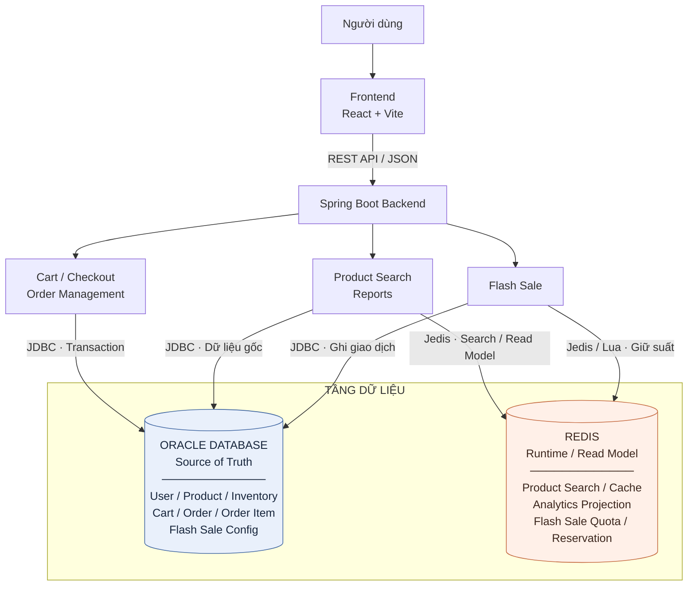

# Phần 1. GIỚI THIỆU ĐỀ TÀI VÀ TỔNG QUAN HỆ THỐNG

## 1.1. Bối cảnh, mục tiêu và phạm vi đề tài

Hệ quản trị cơ sở dữ liệu (DBMS) đóng vai trò quan trọng trong việc lưu trữ, truy xuất và bảo đảm tính toàn vẹn dữ liệu của các ứng dụng. Tuy nhiên, các hệ quản trị quan hệ (SQL) và phi quan hệ (NoSQL) có những khác biệt về mô hình dữ liệu, cơ chế xử lý và đặc tính hiệu năng, dẫn đến mức độ phù hợp khác nhau đối với từng loại nghiệp vụ.

Đề tài lựa chọn **Oracle Database và Redis** làm hai hệ quản trị đại diện để nghiên cứu, thực nghiệm và so sánh trên sáu chủ đề: Data Storage & Management, Indexing, Query Processing, Transaction, Concurrency Control và Data Backup & Recovery. Mục tiêu là làm rõ cơ chế hoạt động, đánh giá kết quả thực nghiệm và xác định cách sử dụng phù hợp của mỗi DBMS trong bối cảnh ứng dụng cụ thể.

Nhóm xây dựng **ShopFlash**, một ứng dụng thương mại điện tử có chức năng mua hàng thông thường và Flash Sale, làm bối cảnh nghiên cứu. Bên cạnh việc hiện thực các nghiệp vụ cơ bản, hệ thống còn hỗ trợ thực hiện và minh họa các thí nghiệm DBMS. Phạm vi triển khai và kiểm chứng tập trung vào môi trường local, không đặt mục tiêu xây dựng một nền tảng thương mại điện tử production hoàn chỉnh.

## 1.2. Tổng quan ứng dụng ShopFlash

ShopFlash là ứng dụng web mô phỏng hoạt động bán lẻ trực tuyến, cho phép người dùng tìm kiếm sản phẩm, quản lý giỏ hàng, đặt hàng và tham gia các chương trình Flash Sale. Hệ thống hỗ trợ khách truy cập, khách hàng có tài khoản và quản trị viên với các quyền truy cập tương ứng.

Hai luồng nghiệp vụ tiêu biểu của hệ thống gồm:

- **Normal Checkout:** Khách hàng lựa chọn sản phẩm, thêm vào giỏ hàng và thực hiện đặt hàng. Backend kiểm tra lại thông tin sản phẩm, giá và tồn kho trước khi tạo đơn, cập nhật tồn kho và giỏ hàng.
- **Flash Sale:** Khách hàng mua sản phẩm có số lượng giới hạn trong thời gian khuyến mãi. Hệ thống kiểm soát số suất còn lại, giới hạn mua theo người dùng và sử dụng reservation tạm thời trước khi xác nhận đơn hàng.

Ngoài các nghiệp vụ mua hàng, ShopFlash còn hỗ trợ quản lý danh mục, sản phẩm và báo cáo thống kê phục vụ hoạt động quản trị.

Các giao diện thực nghiệm về Storage, Indexing, Query Processing và Concurrency Control được xây dựng để hỗ trợ thao tác, quan sát kết quả và kiểm chứng các cơ chế DBMS. Đây là các công cụ phục vụ nghiên cứu, không phải những chức năng nghiệp vụ cốt lõi của hệ thống bán lẻ; nội dung thực nghiệm tương ứng được trình bày tại Phần 2.

## 1.3. Kiến trúc hệ thống và phân chia dữ liệu Oracle–Redis

ShopFlash được xây dựng theo kiến trúc web nhiều tầng, gồm Frontend, Backend và tầng dữ liệu sử dụng đồng thời Oracle Database và Redis.

- **Frontend:** Sử dụng React và Vite, cung cấp giao diện cho khách hàng, quản trị viên và các chức năng hỗ trợ thực nghiệm.
- **Backend:** Xây dựng bằng Java 21 và Spring Boot, cung cấp REST API, xử lý nghiệp vụ, xác thực người dùng và điều phối truy cập dữ liệu.
- **Tầng dữ liệu:** Oracle và Redis được vận hành trong Docker Compose. Backend kết nối Oracle thông qua JDBC và Redis thông qua Jedis.

Các module nghiệp vụ thuộc cùng một ứng dụng Backend, không được triển khai thành các microservice độc lập.

**Kiến trúc tổng thể**

*Hình 1.1. Kiến trúc tổng thể và vai trò của Oracle–Redis trong ShopFlash.*

**Phân chia trách nhiệm dữ liệu**

Hệ thống áp dụng nguyên tắc phân tách dữ liệu theo yêu cầu về tính nhất quán, khả năng lưu trữ và đặc điểm truy cập. Oracle giữ vai trò *source of truth*, trong khi Redis đảm nhiệm các dữ liệu runtime hoặc dữ liệu dẫn xuất phục vụ những tác vụ phù hợp.

| Nhóm dữ liệu | Oracle Database | Redis |
|---|---|---|
| **Sản phẩm và tồn kho** | Lưu Product, Category, Inventory và trạng thái chính thức. | Lưu Product projection phục vụ tìm kiếm, lọc và hiển thị. |
| **Giỏ hàng và đơn hàng** | Quản lý Cart, Order, Order Items và các transaction đặt/hủy đơn. | Lưu dữ liệu dẫn xuất từ Order phục vụ thống kê và báo cáo. |
| **Flash Sale** | Lưu cấu hình chương trình, tồn kho phân bổ, số lượng bán và đơn hàng thành công. | Quản lý quota runtime, giới hạn mua theo người dùng và reservation tạm thời. |
| **Truy vấn và báo cáo** | Cung cấp dữ liệu nghiệp vụ gốc và các truy vấn quan hệ. | Hỗ trợ tìm kiếm, cache và analytics read model. |

*Bảng 1.1. Phân chia trách nhiệm lưu trữ và xử lý dữ liệu giữa Oracle và Redis.*

**Cơ chế phối hợp giữa hai DBMS**

Trong **Normal Checkout**, các thao tác tạo Order, cập nhật Inventory và Cart được thực hiện trong Oracle transaction nhằm bảo đảm tính nhất quán của dữ liệu giao dịch.

Đối với **Flash Sale**, Redis xử lý bước kiểm tra và giữ quota tạm thời để đáp ứng các yêu cầu mua đồng thời. Sau đó, Oracle ghi nhận đơn hàng và cập nhật dữ liệu chính thức. Backend thực hiện xác nhận reservation hoặc bù trừ khi giao dịch không thành công; hai DBMS không sử dụng một distributed transaction chung.

Đối với **tìm kiếm và thống kê**, Redis lưu các bản dữ liệu dẫn xuất (*projection*) được xây dựng từ Oracle nhằm tối ưu việc truy vấn mà không làm thay đổi nguồn dữ liệu chính thức. Product projection được cập nhật sau các thao tác quản lý sản phẩm liên quan, trong khi Analytics projection được tái tạo từ Oracle theo yêu cầu. Do các bản dữ liệu này được cập nhật riêng với giao dịch gốc, chúng có thể phản ánh thay đổi muộn hơn Oracle. Vì vậy, những nghiệp vụ cần xác nhận dữ liệu tại thời điểm xử lý, chẳng hạn kiểm tra giá và tồn kho khi Checkout, vẫn sử dụng trực tiếp dữ liệu Oracle.

Cách tổ chức này cho phép ShopFlash khai thác khả năng quản lý transaction và ràng buộc dữ liệu của Oracle, đồng thời sử dụng Redis cho những workload như tìm kiếm, truy vấn dữ liệu dẫn xuất và kiểm soát Flash Sale runtime. Đây cũng là cơ sở để nhóm triển khai các thí nghiệm so sánh hai DBMS trong Phần 2.
