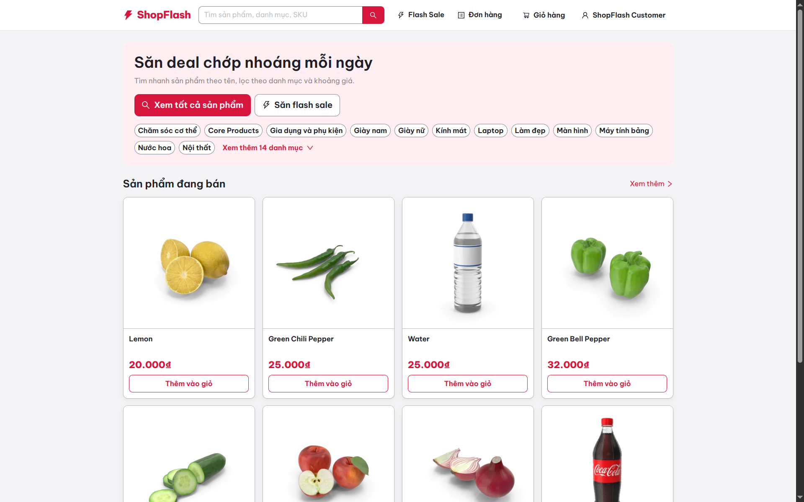
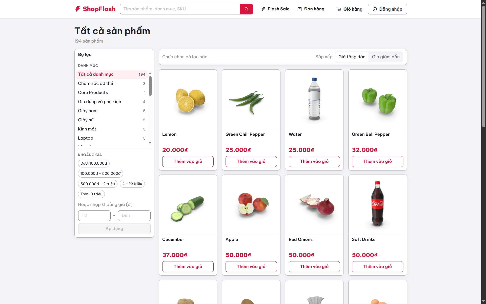
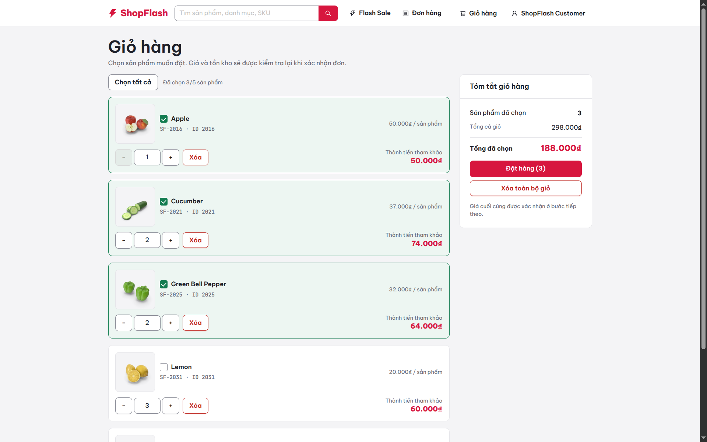
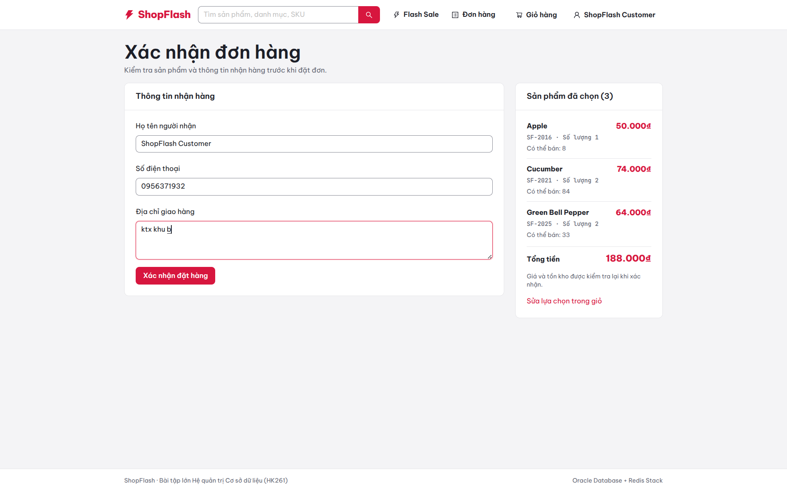
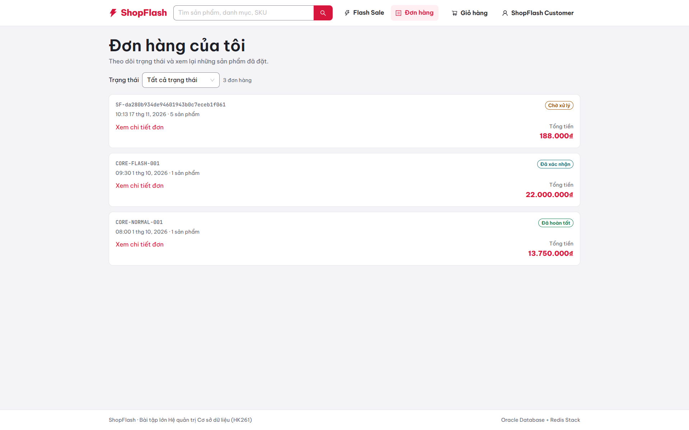
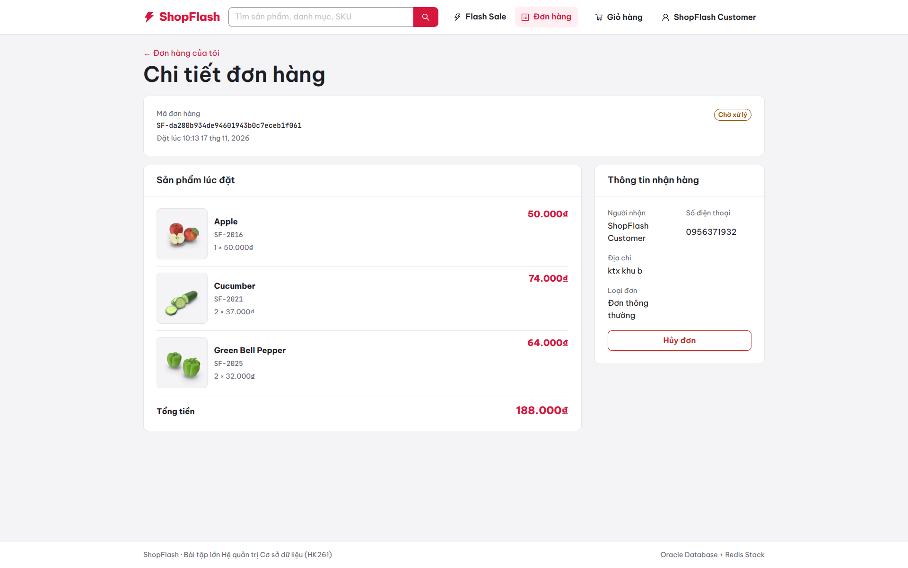

# 3. HIỆN THỰC ỨNG DỤNG VÀ KẾT LUẬN

## 3.1. Các chức năng đã hiện thực

Bên cạnh việc nghiên cứu và so sánh Oracle với Redis, nhóm xây dựng ứng dụng thương mại điện tử ShopFlash nhằm vận dụng các cơ chế DBMS vào những nghiệp vụ cụ thể. Hệ thống cung cấp giao diện cho khách hàng, quản trị viên và các công cụ hỗ trợ quá trình thực nghiệm.

Các chức năng được tổ chức thành bốn nhóm chính:

| Nhóm chức năng | Nội dung hiện thực |
|---|---|
| **Quản lý và tìm kiếm sản phẩm** | Quản lý danh mục, sản phẩm, tồn kho; tìm kiếm, lọc, sắp xếp và xem thông tin sản phẩm. |
| **Giỏ hàng và đơn hàng** | Thêm sản phẩm, điều chỉnh số lượng, lựa chọn sản phẩm đặt hàng, thực hiện Checkout, xem và quản lý đơn hàng. |
| **Flash Sale** | Quản lý chương trình khuyến mãi, kiểm soát quota và giới hạn mua, giữ suất tạm thời và đặt hàng Flash Sale. |
| **Báo cáo và thống kê** | Truy vấn doanh thu, thông tin sản phẩm và khách hàng; hỗ trợ các nguồn dữ liệu Oracle, Redis và cache theo từng chức năng. |

*Bảng 3.1. Tổng hợp các nhóm chức năng chính của ShopFlash.*

Ngoài các chức năng nghiệp vụ, hệ thống còn tích hợp những giao diện thực nghiệm và công cụ hỗ trợ quản trị cơ sở dữ liệu. Các thành phần này giúp nhóm thao tác, quan sát và kiểm chứng các cơ chế được nghiên cứu tại Phần 2.

## 3.2. Minh họa và đánh giá ứng dụng

Các chức năng của ShopFlash được minh họa thông qua những màn hình và luồng nghiệp vụ tiêu biểu. Phần này tập trung vào khả năng tương tác và kết quả vận hành từ góc nhìn người dùng, trong khi các cơ chế kỹ thuật và kết quả thực nghiệm DBMS được trình bày tại Phần 2.

**A. Giao diện phía khách hàng (Client)**

**Nhóm chức năng khám phá và tìm kiếm sản phẩm**

Giao diện trang chủ cung cấp điểm truy cập chính đến danh mục sản phẩm, chức năng tìm kiếm và các chương trình Flash Sale. Người dùng có thể duyệt những sản phẩm đang được bán hoặc chuyển trực tiếp đến trang danh sách sản phẩm để thực hiện tìm kiếm chi tiết.

*Hình 3.1. Giao diện trang chủ ShopFlash với danh mục và danh sách sản phẩm đang bán.*

Trang danh sách sản phẩm hỗ trợ tìm kiếm, lọc theo danh mục, khoảng giá và sắp xếp theo giá. Ở thời điểm minh họa, hệ thống hiển thị 194 sản phẩm cùng bộ lọc và các thông tin cơ bản như hình ảnh, tên và giá bán.

*Hình 3.2. Giao diện danh sách sản phẩm với bộ lọc và chức năng sắp xếp.*

Hai màn hình minh họa khả năng truy xuất và tổ chức dữ liệu sản phẩm phục vụ nhu cầu tìm kiếm. Những cơ chế đánh chỉ mục và xử lý truy vấn tương ứng được phân tích trong các topic Indexing và Query Processing.

**Nhóm chức năng giỏ hàng và xác nhận đặt hàng**

Giỏ hàng cho phép khách hàng thêm, xóa, điều chỉnh số lượng và lựa chọn những sản phẩm muốn đặt trong một lần Checkout. Hệ thống hiển thị giá trị từng dòng sản phẩm, tổng giá trị giỏ hàng và tổng tiền của những sản phẩm đã chọn.

Trong tình huống minh họa, giỏ hàng chứa năm dòng sản phẩm, trong đó khách hàng chọn ba dòng để đặt hàng với tổng giá trị **188.000 đồng**. Việc lựa chọn từng dòng giúp khách hàng chỉ mua một phần giỏ hàng mà không cần xóa các sản phẩm còn lại.

*Hình 3.3. Giao diện giỏ hàng, lựa chọn sản phẩm và tổng hợp giá trị đặt hàng.*

Sau khi chuyển đến bước Checkout, hệ thống hiển thị danh sách sản phẩm đã chọn, số lượng, thành tiền và thông tin nhận hàng. Khách hàng cung cấp tên, số điện thoại, địa chỉ giao hàng và kiểm tra lại đơn trước khi xác nhận.

Ở ví dụ này, đơn hàng gồm ba dòng sản phẩm: Apple (1), Cucumber (2) và Green Bell Pepper (2), với tổng tiền 188.000 đồng. Giao diện cũng hiển thị số lượng có thể bán của từng sản phẩm để người dùng tham khảo.

*Hình 3.4. Giao diện xác nhận đơn hàng với thông tin nhận hàng và danh sách sản phẩm.*

Thông tin giá và tồn kho được Backend kiểm tra lại khi người dùng xác nhận đặt hàng. Các thao tác tạo đơn, cập nhật tồn kho và giỏ hàng được quản lý trong Oracle transaction nhằm duy trì tính nhất quán của dữ liệu nghiệp vụ.

**Nhóm chức năng theo dõi và quản lý đơn hàng**

Sau khi đặt hàng, khách hàng có thể truy cập trang danh sách đơn để theo dõi những đơn đã tạo. Mỗi đơn được hiển thị với mã định danh, thời gian đặt, số lượng sản phẩm, tổng tiền và trạng thái xử lý.

Hình 3.5 minh họa danh sách các đơn ở những trạng thái khác nhau, gồm Chờ xử lý, Đã xác nhận và Đã hoàn tất. Trong đó, đơn hàng mới có tổng giá trị **188.000 đồng**, gồm năm đơn vị sản phẩm và trạng thái **PENDING (Chờ xử lý)**.

*Hình 3.5. Giao diện danh sách đơn hàng và trạng thái xử lý.*

Từ danh sách, người dùng có thể mở trang chi tiết để xem lại các sản phẩm đã mua, đơn giá, số lượng, thông tin nhận hàng và trạng thái đơn. Giá và thông tin sản phẩm được ghi nhận tại thời điểm đặt, giúp duy trì lịch sử đơn hàng ngay cả khi dữ liệu sản phẩm thay đổi về sau.

Hình 3.6 thể hiện chi tiết đơn hàng vừa tạo, với ba dòng sản phẩm và tổng tiền 188.000 đồng, khớp với thông tin đã xác nhận tại bước Checkout. Đối với đơn hàng thông thường còn ở trạng thái PENDING, hệ thống cung cấp chức năng hủy đơn theo điều kiện nghiệp vụ.

*Hình 3.6. Giao diện chi tiết đơn hàng, sản phẩm đã mua và chức năng hủy đơn.*

Nhóm màn hình này cho thấy luồng sử dụng liên tục từ giỏ hàng, xác nhận đặt hàng đến truy xuất đơn đã tạo. Các thông tin về số lượng và giá trị đơn được thể hiện nhất quán giữa những bước của giao diện.

**Nhóm chức năng Flash Sale**

Bên cạnh mua hàng thông thường, ShopFlash hỗ trợ các chương trình Flash Sale với số lượng sản phẩm được phân bổ giới hạn. Người dùng có thể xem sản phẩm đang tham gia chương trình, thực hiện giữ suất trong khoảng thời gian quy định và tiến hành đặt hàng.

Khác với Normal Checkout, luồng Flash Sale sử dụng Redis để quản lý quota và reservation tạm thời, trong khi Oracle lưu trữ đơn hàng và trạng thái nghiệp vụ chính thức. Chức năng này minh họa việc phối hợp hai DBMS trong bài toán mua hàng có cạnh tranh về số lượng.

*[Hình 3.7 — Giao diện Flash Sale và kết quả giữ suất hoặc đặt hàng. Bổ sung từ ảnh thực tế khi hoàn thiện minh chứng.]*

**B. Giao diện phía quản trị (Admin)**

Ngoài các chức năng dành cho khách hàng, ShopFlash cung cấp giao diện quản trị nhằm quản lý dữ liệu và vận hành các nghiệp vụ của hệ thống. Phần này tập trung giới thiệu các nhóm chức năng tiêu biểu, không trình bày toàn bộ công cụ hỗ trợ thực nghiệm đã được phân tích tại Phần 2.

*[Thành viên phụ trách Admin bổ sung phần minh họa quản lý sản phẩm, quản lý Flash Sale và báo cáo/thống kê. Mỗi nhóm chỉ cần một đoạn mô tả ngắn cùng ảnh giao diện tiêu biểu.]*

**C. Đánh giá kết quả vận hành**

Các màn hình Client minh họa một luồng nghiệp vụ xuyên suốt, từ tìm kiếm sản phẩm, quản lý giỏ hàng đến đặt và theo dõi đơn hàng. Trong tình huống được trình bày, thông tin sản phẩm, số lượng và tổng tiền của đơn 188.000 đồng được thể hiện phù hợp giữa bước Checkout và trang chi tiết đơn hàng.

Ứng dụng cho phép người dùng thao tác thông qua React Frontend, thực hiện nghiệp vụ tại Spring Boot Backend và khai thác dữ liệu từ Oracle–Redis theo trách nhiệm đã thiết kế. Các ảnh giao diện là bằng chứng về kết quả hiển thị và khả năng tương tác; tính đúng đắn của cập nhật cơ sở dữ liệu và xử lý đồng thời được đánh giá thông qua các thí nghiệm, kiểm thử tương ứng tại Phần 2.

## 3.3. Kết luận, hạn chế và hướng phát triển

**Kết quả đạt được**

Đề tài nghiên cứu và so sánh Oracle Database với Redis theo sáu chủ đề của môn học, kết hợp phân tích cơ chế, thực nghiệm và đánh giá trong bối cảnh ứng dụng thương mại điện tử ShopFlash. Kết quả của từng chủ đề cung cấp cơ sở để xác định những đặc điểm và phạm vi ứng dụng phù hợp của hai hệ quản trị.

Song song với nghiên cứu, nhóm đã xây dựng ứng dụng ShopFlash với các chức năng bán hàng, quản lý đơn hàng, Flash Sale và báo cáo thống kê. Hệ thống sử dụng Oracle làm nguồn dữ liệu nghiệp vụ chính, kết hợp Redis cho các tác vụ runtime, tìm kiếm và dữ liệu dẫn xuất.

**Hạn chế và hướng phát triển**

Phạm vi triển khai và kiểm chứng hiện tập trung vào môi trường local. Trong những giai đoạn tiếp theo, nhóm có thể mở rộng đánh giá trên các workload lớn hơn, tăng cường kiểm thử truy cập đồng thời, hoàn thiện cơ chế đồng bộ và phục hồi dữ liệu, cũng như khảo sát khả năng vận hành trong môi trường triển khai thực tế.

**Tự đánh giá**

Đề tài đáp ứng định hướng kết hợp nghiên cứu DBMS với xây dựng ứng dụng, cung cấp những tình huống nghiệp vụ cụ thể để kiểm chứng và lựa chọn các cơ chế quản lý dữ liệu. Những kết quả thu được có giá trị trong phạm vi mô hình và điều kiện thực nghiệm đã triển khai, đồng thời là cơ sở để tiếp tục phát triển hệ thống.
